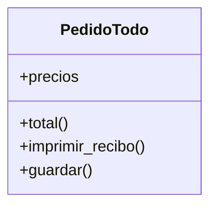
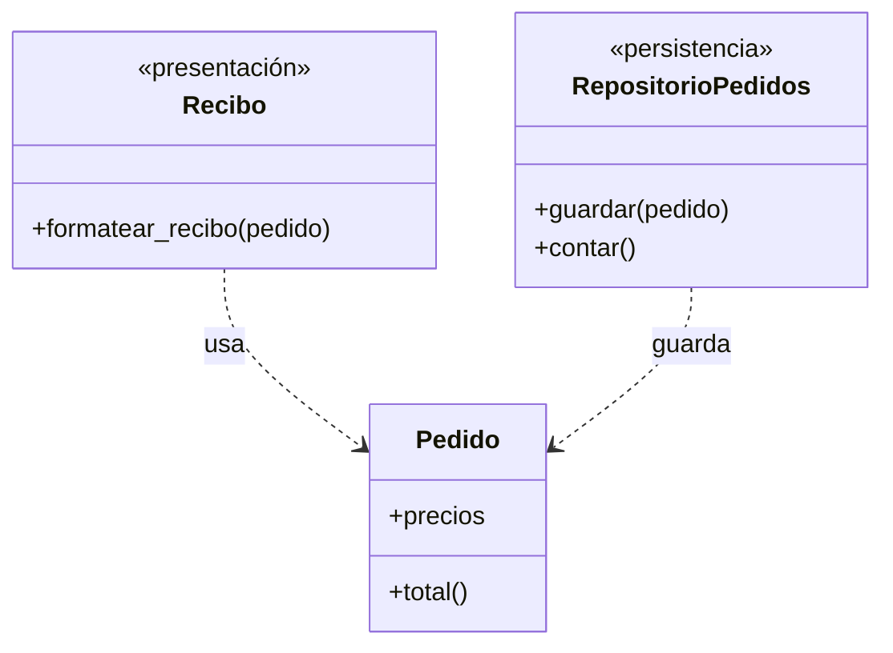

# Lección 13 — SRP (Single Responsibility Principle)

> Fase 0 · Formulario · SOLID · Familia de concepto: **una sola razón para cambiar** · Orden de estudio: **14 de 18**

⬅️ [Lección 12 · Abstracción](../12-abstraccion/) · 🏠 [Índice de lecciones](../README.md) · ➡️ [Lección 14 · OCP](../14-ocp/)

---

## 🧭 Ruta de estudio · Lección 13 (≈ 1.5 h)

**Antes necesitas:** [Lección 06 · Clases y objetos](../06-clases-y-objetos/) (`class`, métodos) y [Lección 08 · Módulos y pytest](../08-modulos-y-pytest/) (correr tests).

| Paso | Qué haces | Dónde | ⏱ |
|:-:|---|---|:-:|
| **0** | Lee la teoría, las recetas, el diagnóstico, las propiedades y los errores | este README §0–§8 | 20 min |
| **1** | Ejecuta las recetas y mira el "antes → después" de cada una | [`paso1_formulas.py`](paso1_formulas.py) | 10 min |
| **2** | Sigue los ejemplos resueltos (violación → refactor) | §9 + [`paso2_ejemplos_resueltos.py`](paso2_ejemplos_resueltos.py) | 15 min |
| **3** | Corre los tests (salen en **rojo**) y completa los `# TODO` hasta verlos en **verde** | [`paso3_tu_turno.py`](paso3_tu_turno.py) + [`test_paso3_tu_turno.py`](test_paso3_tu_turno.py) | 20 min |
| **4** | Compara con la solución de referencia | [`paso4_tu_turno_solucion.py`](paso4_tu_turno_solucion.py) | 5 min |
| **5** | Resuelve los 12 problemas, luego revisa claves y solucionario | §10–§11 + [`paso5_solucionario/`](paso5_solucionario/) | 20 min |
| **6** | Compara solución mala vs buena | [`paso6_ejercicios/`](paso6_ejercicios/) | 10 min |
| **7** | Responde las preguntas de recuerdo **sin mirar** | §15 | 5 min |
| **🚦** | Evalúa si puedes pasar a la siguiente | §16 | 1 min |

---

## 0. 🧭 La pregunta
> *"Mi clase hace de todo (calcular, mostrar, guardar). Cada cambio toca la misma
> clase y rompe lo demás. ¿Cómo la ordeno?"*

## 1. Objetivos (al terminar podrás…)
1. Explicar el SRP con la frase **"una sola razón para cambiar"**.
2. Detectar una violación con la **regla del "y"** y con las preguntas de diagnóstico (§6).
3. Separar **regla de negocio**, **presentación** y **persistencia** en piezas distintas.
4. Escribir una función que **orquesta** piezas pequeñas (la idea del *service layer* del libro).

## 2. Cita de la fuente
> *"SOLID is an acronym for Robert C. Martin's five principles of object-oriented design:
> single responsibility, open for extension but closed for modification, Liskov
> substitution, interface segregation, and dependency inversion."* — Introducción (nota 2)

> *"Really, this is a violation of the single responsibility principle (SRP). Our use case
> is allocation. Our endpoint, service function, and domain methods are all called
> allocate, not allocate_and_send_mail_if_out_of_stock."* — Cap. 8

> *"Rule of thumb: if you can't describe what your function does without using words like
> "then" or "and," you might be violating the SRP."* — Cap. 8

> *"One formulation of the SRP is that each class should have only a single reason to
> change. When we switch from email to SMS, we shouldn't have to update our allocate()
> function, because that's clearly a separate responsibility."* — Cap. 8

**Por qué importa:** el SRP es la **S** de SOLID y el libro lo usa como argumento central del
cap. 8: la regla de **asignar** stock no debe **también** mandar emails. De ahí nacen los
eventos y el *message bus*.

## 3. El dolor
```python
class Pedido:
    def total(self): ...            # cambia si cambia la REGLA del negocio
    def imprimir_recibo(self): ...  # cambia si cambia el FORMATO del recibo
    def guardar(self): ...          # cambia si cambia la BASE DE DATOS
```
Tres motivos distintos tocan **la misma clase**. Si el diseñador pide otro formato de recibo,
editas `Pedido`… y puedes romper el cálculo del total, que no tenía nada que ver.

---

## 4. 📘 Teoría

> **🎯 Definición — SRP (Principio de Responsabilidad Única)**
> Cada clase (o función) debe tener **una sola responsabilidad**, es decir, **una sola razón
> para cambiar**.
> "Razón para cambiar" = un **motivo** o una **persona/área** que pediría modificarla
> (negocio, diseño, base de datos, notificaciones…).

> **🧩 Las tres responsabilidades más comunes**
>
> | Responsabilidad | Pregunta que responde | Ejemplo |
> |---|---|---|
> | **Regla de negocio** | ¿qué se calcula o se decide? | `Pedido.total()` |
> | **Presentación** | ¿cómo se muestra? | `formatear_recibo(pedido)` |
> | **Persistencia** | ¿dónde y cómo se guarda? | `RepositorioPedidos.guardar(pedido)` |
>
> Y una cuarta que las une: **orquestar** (llamar a las piezas en orden), como hace la *service
> layer* del libro.

> **🔤 Vocabulario**
> - **Responsabilidad:** un motivo por el que el código podría tener que cambiar.
> - **Cohesión:** qué tan relacionadas están las cosas dentro de una pieza (queremos **alta**).
> - **Acoplamiento:** cuánto depende una pieza de otra (queremos **bajo**).
> - **Orquestar:** coordinar varias piezas pequeñas sin hacer su trabajo.
> - **Clase "Dios":** una clase que hace de todo (`Manager`, `Utils`, `Sistema`…).

> **🧠 Regla de oro** (del libro)
> Si no puedes describir lo que hace tu función **sin usar "y" o "luego"**, probablemente
> viola el SRP.

---

## 5. 🧮 Formulario: recetas SRP
| # | Síntoma / olor | Regla | Plantilla de código | Qué logra |
|---|---|---|---|---|
| S1 | La clase **calcula y muestra** | Separa la **regla** de la **presentación** | `class Pedido: def total(self)` + `def formatear_recibo(pedido)` | Cambiar el formato no toca el cálculo |
| S2 | La clase **calcula y se guarda** | Separa la **persistencia** en un repositorio | `class RepositorioPedidos: def guardar(self, pedido)` | Cambiar la base de datos no toca la regla |
| S3 | Función con **"y"** en el nombre (`calcular_y_mostrar`) | Divide en dos funciones + una que **orquesta** | `p = promedio(notas)` · `mostrar(p)` | Cada parte se reusa por separado |
| S4 | La función **pide datos, calcula e imprime** | **Núcleo puro** (recibe y devuelve) + **borde** (`print`/`input`) | `def con_igv(monto): return monto * 118 / 100` | El núcleo se prueba sin pantalla |
| S5 | La regla de negocio **envía avisos** (email) | La regla devuelve el **resultado**; otro decide avisar | `if not hay_stock(...): avisar(...)` | Pasar de email a SMS sin tocar la regla (cap. 8) |
| S6 | **Clase "Dios"** que hace todo | Una clase por **motivo de cambio** | `Carrito` · `formatear_ticket` · `RepositorioCarritos` | Cambios localizados, piezas pequeñas |

> 💡 Todas las recetas están ejecutables en [`paso1_formulas.py`](paso1_formulas.py), con su
> código (S1…S6) en cada línea de salida.

## 6. 🔍 Diagnóstico: ¿esta pieza viola el SRP?
| # | Pregunta | Si respondes… | …entonces |
|---|---|---|---|
| G1 | ¿Puedo describirla **sin "y" ni "luego"**? | No | Tiene más de una responsabilidad → S3 |
| G2 | ¿**Cuántas áreas** pedirían cambiarla (negocio, diseño, BD, avisos)? | Más de una | Sepárala por área → S1, S2, S5 |
| G3 | Si cambio el **formato** de salida, ¿toco esta clase? | Sí, y además calcula | Mezcla regla y presentación → S1 |
| G4 | ¿Tiene `print`/`input`/archivos **mezclados** con cálculos? | Sí | Saca el borde → S4 |
| G5 | ¿Su nombre es genérico (`Manager`, `Utils`, `procesar_todo`)? | Sí | Probable clase "Dios" → S6 |
| G6 | Para **probarla**, ¿tengo que preparar cosas ajenas (pantalla, archivo, email)? | Sí | Hay responsabilidades de más → S2, S4, S5 |

## 7. 📐 Propiedades y consecuencias
| # | Propiedad |
|---|---|
| **P1** | Cada pieza cambia por **un solo motivo**: los cambios quedan **localizados**. |
| **P2** | Piezas pequeñas y enfocadas son **más fáciles de probar** (el núcleo no imprime ni guarda). |
| **P3** | SRP **no** significa "un método por clase": una clase puede tener varios métodos si **todos cambian por el mismo motivo**. |
| **P4** | **Orquestar** también es una responsabilidad; en el libro la tiene la *service layer*. |
| **P5** | Aumenta la **cohesión** (todo lo de adentro está relacionado) y baja el **acoplamiento**. |
| **P6** | Es la base de los demás patrones del libro: Repository (persistencia aparte) y eventos (avisos aparte). |

## 8. ⚠️ Errores frecuentes
| # | ❌ Así no | Qué pasa | ✅ Así sí |
|---|---|---|---|
| E1 | "SRP = **un método por clase**" | Decenas de clases diminutas y sin sentido | Agrupa lo que **cambia junto** (P3) |
| E2 | Separar en otro archivo pero dejar el `print` **dentro** de la regla | Sigue mezclado: cambiar el formato toca la regla | La regla **devuelve** datos; otra pieza los muestra |
| E3 | Partir la clase "por si acaso", sin dolor real | Sobreingeniería, código difícil de seguir | Separa cuando aparece la **segunda razón** para cambiar |
| E4 | Esconder la otra responsabilidad en un método "privado" (`_guardar`) | Sigue habiendo dos razones para cambiar | **Muévela fuera** de la clase |
| E5 | Mandar el email **dentro** de la regla de dominio | Pasar a SMS obliga a editar `asignar` (cap. 8) | La regla devuelve el resultado; el aviso va aparte |
| E6 | Nombres como `procesar_todo` o `Utils` | El nombre no dice **qué** hace: invita a meter más cosas | Nombres que digan **una** cosa: `total`, `formatear_recibo` |

---

## 9. ✍️ Ejemplos resueltos (violación → refactor)
> Todos están en [`paso2_ejemplos_resueltos.py`](paso2_ejemplos_resueltos.py).

**Ejemplo 1 — Pedido que calcula y arma el recibo** *(fácil)*
> Enunciado: `PedidoTodo` calcula el total **e** imprime el recibo. Sepáralo.
```python
# Paso 1 (violación): dos razones para cambiar en una clase.
class PedidoTodo:
    def __init__(self, precios):
        self.precios = precios
    def total(self):
        return sum(self.precios)
    def imprimir_recibo(self):
        print("Total a pagar:", self.total())

# Paso 2 (refactor, receta S1): la regla en la clase, la presentación aparte.
class Pedido:
    def __init__(self, precios):
        self.precios = precios
    def total(self):
        return sum(self.precios)

def formatear_recibo(pedido):
    return f"Total a pagar: {pedido.total()}"

# Paso 3 (uso)
print(formatear_recibo(Pedido([10, 20, 30])))   # -> Total a pagar: 60
```

**Ejemplo 2 — Función con "y" en el nombre** *(fácil)*
> Enunciado: `calcular_y_mostrar_promedio` calcula **y** muestra. No puedo usar el promedio
> sin imprimirlo.
```python
# Paso 1 (violación)
def calcular_y_mostrar_promedio(notas):
    print("Promedio:", sum(notas) / len(notas))

# Paso 2 (refactor, receta S3): una calcula (devuelve), otra muestra.
def promedio(notas):
    return sum(notas) / len(notas)

def mostrar(etiqueta, valor):
    print(etiqueta, valor)

# Paso 3 (uso): el promedio ahora sirve también para DECIDIR.
p = promedio([12, 15, 18])
mostrar("Promedio:", p)        # -> Promedio: 15.0
print("¿Aprobado?", p >= 11)   # -> ¿Aprobado? True
```

**Ejemplo 3 — Pedido que además se guarda** *(intermedio)*
> Enunciado: `PedidoQueSeGuarda` calcula **y** se guarda en una "base de datos". Saca la
> persistencia.
```python
# Paso 1 (violación): la clase sabe calcular Y guardarse.
class PedidoQueSeGuarda:
    base_de_datos = []
    def __init__(self, precios):
        self.precios = precios
    def total(self):
        return sum(self.precios)
    def guardar(self):
        PedidoQueSeGuarda.base_de_datos.append(self)

# Paso 2 (refactor, receta S2): guardar pasa a un REPOSITORIO (patrón del cap. 2).
class RepositorioPedidos:
    def __init__(self):
        self._pedidos = []
    def guardar(self, pedido):
        self._pedidos.append(pedido)
    def contar(self):
        return len(self._pedidos)

# Paso 3 (uso)
repo = RepositorioPedidos()
repo.guardar(Pedido([5, 5]))
repo.guardar(Pedido([1, 2, 3]))
print("Pedidos guardados:", repo.contar())                  # -> 2
print("¿Pedido sabe guardarse?", hasattr(Pedido([1]), "guardar"))   # -> False
```
`hasattr(objeto, "nombre")` responde `True` o `False`: ¿el objeto tiene ese atributo o método?

**Ejemplo 4 — Asignar que también manda email, como en el cap. 8** *(avanzado)*
> Enunciado: la regla de asignar stock **también** envía el email cuando no hay stock. Haz
> que pasar a SMS no obligue a tocar la regla.
```python
# Paso 1 (violación): allocate_and_send_mail_if_out_of_stock, en versión casera.
def asignar_y_enviar_email(stock, sku, cantidad):
    if stock.get(sku, 0) >= cantidad:
        stock[sku] = stock[sku] - cantidad
        return "asignado"
    print("EMAIL: sin stock de", sku)
    return "sin stock"

# Paso 2 (refactor, receta S5): la regla solo asigna y devuelve el resultado.
def asignar(stock, sku, cantidad):
    if stock.get(sku, 0) >= cantidad:
        stock[sku] = stock[sku] - cantidad
        return True
    return False

def avisar_sms(mensaje):
    print("SMS:", mensaje)

# Paso 3 (orquestar): otra función junta las piezas y elige el canal del aviso.
def servicio_asignar(stock, sku, cantidad, avisar):
    if asignar(stock, sku, cantidad):
        return "asignado"
    avisar(f"sin stock de {sku}")
    return "sin stock"

print(servicio_asignar({"MESA": 2}, "MESA", 5, avisar_sms))   # -> SMS: sin stock de MESA / sin stock
print(servicio_asignar({"MESA": 9}, "MESA", 5, avisar_sms))   # -> asignado
```
Cambiamos email por SMS **sin tocar `asignar`**: exactamente lo que pide la cita del cap. 8.

---

## 10. 📝 Problemas propuestos
> Resuélvelos **antes** de mirar las claves. Puedes crear tu propio archivo
> (`mis_problemas.py`) en esta carpeta.

**🟢 Nivel básico**
1. `class Reporte` tiene `calcular()` (suma las ventas) e `imprimir()` (las muestra). ¿Cuántas
   razones para cambiar tiene? ¿Cuáles?
2. Aplica la regla del "y": ¿viola el SRP una función llamada `validar_y_guardar_usuario`?
3. Separa `saludar_y_contar(nombres)` (saluda a cada nombre **y** devuelve cuántos son) en
   dos funciones: `saludar(nombres)` y `contar(nombres)`. Pruébalas con `["Ana", "Luis"]`.
4. ¿Qué responsabilidad tiene `formatear_recibo(pedido)`: regla, presentación o persistencia?

**🟡 Nivel intermedio**

5. `class Alumno` tiene `promedio()` e `imprimir_boletin()`. Refactoriza: deja `promedio()` en
   la clase y crea `imprimir_boletin(alumno)` fuera. Pruébalo con Ana, notas `[14, 16, 18]`.
6. `class Inventario` guarda productos **y** escribe un log con `print`. Crea `class Registro`
   (con `anotar(texto)` que guarda en una lista) y haz que `Inventario` la **use**.
7. `procesar_pedido(precios)` suma, aplica IGV 18 % e imprime. Divídela en `total`, `con_igv`
   y `mostrar`. Para `[50, 50]` debe mostrar `Total con IGV: 118.0`.
8. Después de tu refactor del problema 7, ¿qué pieza tocarías para cada cambio?
   a) el formato de moneda, b) la tasa de IGV pasa a 19 %, c) guardar el pedido en un archivo.

**🔴 Nivel avanzado**

9. La clase "Dios" `Tienda` tiene `agregar_producto`, `calcular_total`, `imprimir_ticket` y
   `guardar`. Divídela en `Carrito`, `formatear_ticket` y `RepositorioCarritos`. Prueba con
   mesa (100) y lámpara (30).
10. Escribe 2 `assert` que prueben `Carrito.total()`. ¿Por qué es fácil probarlo ahora?
11. `registrar_venta(ventas, monto)` llama adentro a `enviar_email`. Haz que reciba **cómo
    avisar** como parámetro, y úsala una vez con email y otra con SMS **sin editarla**.
12. *(Puente al libro)* Escribe `asignar(lotes, sku, cantidad)`, que solo elige el primer lote
    con stock suficiente y devuelve su referencia (o `None`), y `servicio_asignar(...)`, que
    llama a `asignar` y avisa si no hubo stock. Usa
    `lotes = {"lote-1": {"sku": "MESA", "disponible": 10}, "lote-2": {"sku": "SILLA", "disponible": 3}}`.

## 11. 🔑 Claves (respuestas)
<details><summary>Ver claves (solo después de intentarlo)</summary>

| # | Respuesta / salida esperada | Receta / idea |
|---|---|---|
| 1 | **2 razones**: la regla del cálculo y el formato de impresión → viola el SRP | G2 |
| 2 | **Sí**: el nombre describe dos cosas (validar **y** guardar) | regla del "y" |
| 3 | `Hola, Ana` / `Hola, Luis` y cantidad `2` | S3 |
| 4 | **Presentación** (cómo se muestra el total) | §4 tabla |
| 5 | `Ana -> promedio 16.0` | S1 |
| 6 | `['mesa', 'silla']` y log `['agregado mesa', 'agregado silla']` | S2 / S6 |
| 7 | `Total con IGV: 118.0` | S4 |
| 8 | a) `mostrar` · b) `con_igv` · c) una pieza **nueva** (un repositorio); no se toca ninguna | P1 |
| 9 | `2 productos \| total 130 \| guardados: 1` | S6 |
| 10 | `assert c.total() == 130` y `assert Carrito().total() == 0` pasan. Es fácil porque `total()` no imprime ni guarda | P2 |
| 11 | `EMAIL -> venta registrada: 50` y `SMS -> venta registrada: 70`; ventas `[50, 70]` | S5 |
| 12 | `lote-1` para MESA×4; para SILLA×5 avisa `sin stock para SILLA` y devuelve `None` | S5 + cap. 8 |

El código completo de cada solución está en [`paso5_solucionario/`](paso5_solucionario/):
[`nivel_basico.py`](paso5_solucionario/nivel_basico.py) ·
[`nivel_intermedio.py`](paso5_solucionario/nivel_intermedio.py) ·
[`nivel_avanzado.py`](paso5_solucionario/nivel_avanzado.py).
</details>

---

## 12. 🗺️ Diagrama antes / después (Mermaid)
**Antes** — una clase con tres razones para cambiar:

**Después** — una pieza por responsabilidad:

**Cómo leerlo:** antes, `PedidoTodo` mezcla regla (`total`), presentación (`imprimir_recibo`) y
persistencia (`guardar`). Después, `Pedido` solo conoce la regla; la presentación y la
persistencia lo **usan** desde afuera (flecha punteada = "depende de"). Si cambia el formato,
solo cambia `Recibo`; si cambia la base de datos, solo cambia `RepositorioPedidos`.

## 13. 🌳 Árbol de archivos
```
lecciones/13-srp/
├── README.md                    ← PASO 0 · EMPIEZA AQUÍ (este formulario)
├── paso1_formulas.py            ← PASO 1 · las recetas S1–S6, ejecutables
├── paso2_ejemplos_resueltos.py  ← PASO 2 · los 4 ejemplos (violación → refactor)
├── paso3_tu_turno.py            ← PASO 3 · completa los # TODO
├── test_paso3_tu_turno.py       ← PASO 3 · los tests (rojo → verde)
├── paso4_tu_turno_solucion.py   ← PASO 4 · solución de referencia
├── paso5_solucionario/          ← PASO 5 · soluciones de los 12 problemas
│   ├── nivel_basico.py
│   ├── nivel_intermedio.py
│   └── nivel_avanzado.py
└── paso6_ejercicios/            ← PASO 6 · solución mala vs buena
    ├── ejercicio-1/ … ejercicio-3/
    └── ejercicio-4-reto/
```

## 14. 🤝 Tu turno y ✅ comprobación con pytest
Desde la Lección 08 la comprobación es con **pytest**, al estilo **TDD**: los tests ya están
escritos y **empiezan en rojo a propósito**. Tu trabajo es completar los `# TODO` de
[`paso3_tu_turno.py`](paso3_tu_turno.py) hasta que pasen a **verde**.
```bash
uv run pytest lecciones/13-srp -q
# al empezar: 3 failed, 1 passed   (rojo: falta tu código)
# al terminar: 4 passed            (verde)
```
El último test comprueba que `Factura` **no** tenga métodos `guardar`, `imprimir` ni
`formatear`: es el SRP convertido en test.

Para comparar con la referencia:
```bash
git diff --no-index lecciones/13-srp/paso3_tu_turno.py lecciones/13-srp/paso4_tu_turno_solucion.py
```

## 15. ❓ Preguntas de recuerdo
> Respóndelas **sin mirar**; luego abre cada una para comprobar.

<details><summary>1. ¿Qué dice el SRP en una frase?</summary>

Cada clase o función debe tener **una sola razón para cambiar**.
</details>
<details><summary>2. ¿Cuál es la "regla del y" del libro?</summary>

Si no puedes describir lo que hace tu función sin usar "y" o "luego", probablemente viola el SRP.
</details>
<details><summary>3. ¿Por qué separar la presentación de la regla de negocio?</summary>

Porque cambian por motivos distintos: cambiar el formato no debe arriesgar el cálculo, y la
regla se puede probar sin pantalla.
</details>
<details><summary>4. ¿SRP significa "un método por clase"?</summary>

**No.** Una clase puede tener varios métodos si todos cambian por el mismo motivo.
</details>
<details><summary>5. En el cap. 8, ¿por qué <code>allocate</code> no debe mandar el email?</summary>

Porque avisar es otra responsabilidad: al pasar de email a SMS no deberíamos tocar
`allocate()`.
</details>
<details><summary>6. ¿Qué pieza "orquesta" y qué hace?</summary>

Una función (en el libro, la *service layer*) que llama a las piezas pequeñas en orden, sin
hacer el trabajo de ellas.
</details>

---

## 16. 🚦 ¿Puedo pasar a la siguiente lección?
| Indicador | Criterio |
|:-:|---|
| 🟢 **Sí, sigue** | `uv run pytest lecciones/13-srp -q` sale en **verde** (4 passed) **y** aciertas **≥ 9 de 12** problemas **y** respondes las 6 preguntas sin mirar |
| 🟡 **Repasa** | aciertas **6 a 8** → vuelve a §8 (errores frecuentes) y §9 (ejemplos resueltos) y reintenta los que fallaste |
| 🔴 **Repite la lección** | aciertas **menos de 6** → empieza otra vez desde el Paso 0 |

Cuando estés en 🟢, marca la lección en
[`progreso/fase-0-python.md`](../../progreso/fase-0-python.md) (sección *"Mi avance"*) y haz
commit; así también practicas Git.

---

⬅️ [Lección 12 · Abstracción](../12-abstraccion/) · 🏠 [Índice de lecciones](../README.md) · ➡️ [Lección 14 · OCP](../14-ocp/)
