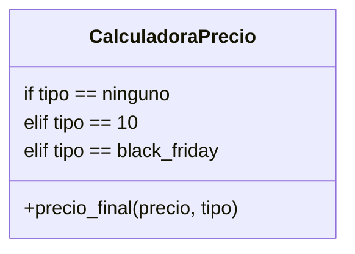
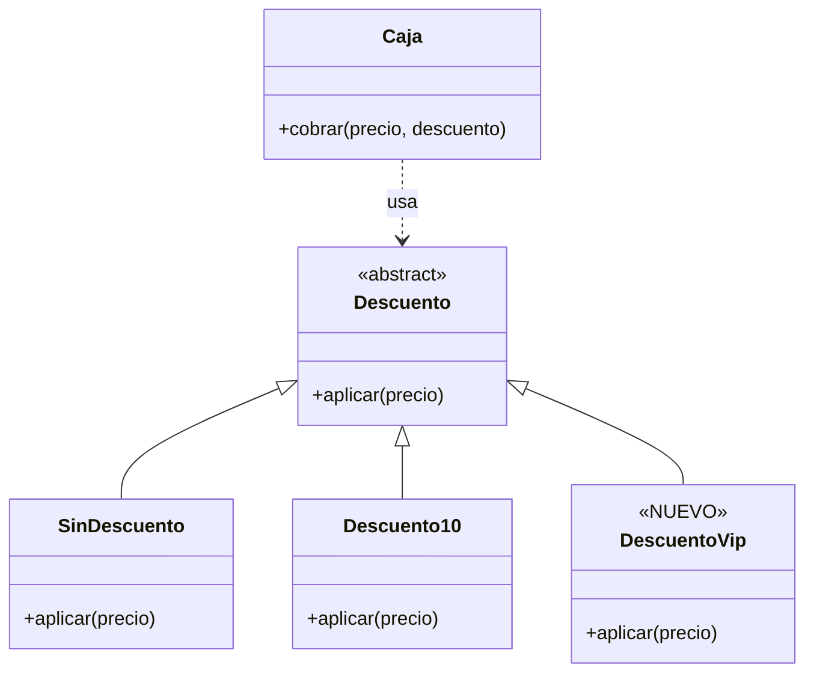

# Lección 14 — OCP (Open/Closed Principle)

> Fase 0 · Formulario · SOLID · Familia de concepto: **extender sin modificar** · Orden de estudio: **15 de 18**

⬅️ [Lección 13 · SRP](../13-srp/) · 🏠 [Índice de lecciones](../README.md) · ➡️ [Lección 15 · LSP](../15-lsp/)

---

## 🧭 Ruta de estudio · Lección 14 (≈ 1.5 h)

**Antes necesitas:** [Lección 11 · Polimorfismo](../11-polimorfismo/) (misma interfaz, distinto comportamiento) y [Lección 13 · SRP](../13-srp/) (una razón para cambiar).

| Paso | Qué haces | Dónde | ⏱ |
|:-:|---|---|:-:|
| **0** | Lee la teoría, las recetas, el diagnóstico, las propiedades y los errores | este README §0–§8 | 20 min |
| **1** | Ejecuta las recetas: mira cómo se agrega un caso **sin editar** el núcleo | [`paso1_formulas.py`](paso1_formulas.py) | 10 min |
| **2** | Sigue los ejemplos resueltos (violación → refactor → extensión) | §9 + [`paso2_ejemplos_resueltos.py`](paso2_ejemplos_resueltos.py) | 15 min |
| **3** | Corre los tests (salen en **rojo**) y completa los `# TODO` hasta verlos en **verde** | [`paso3_tu_turno.py`](paso3_tu_turno.py) + [`test_paso3_tu_turno.py`](test_paso3_tu_turno.py) | 20 min |
| **4** | Compara con la solución de referencia | [`paso4_tu_turno_solucion.py`](paso4_tu_turno_solucion.py) | 5 min |
| **5** | Resuelve los 12 problemas, luego revisa claves y solucionario | §10–§11 + [`paso5_solucionario/`](paso5_solucionario/) | 20 min |
| **6** | Compara solución mala vs buena | [`paso6_ejercicios/`](paso6_ejercicios/) | 10 min |
| **7** | Responde las preguntas de recuerdo **sin mirar** | §15 | 5 min |
| **🚦** | Evalúa si puedes pasar a la siguiente | §16 | 1 min |

---

## 0. 🧭 La pregunta
> *"Cada descuento nuevo me obliga a editar la función de precios y meter otro `if`.
> ¿Cómo agrego comportamientos sin tocar lo que ya funciona?"*

## 1. Objetivos (al terminar podrás…)
1. Explicar el OCP: **abierto a extensión, cerrado a modificación**.
2. Reconocer el olor principal: un `if/elif` que **crece** con cada caso nuevo.
3. Aplicar 3 técnicas de extensión: **pasar funciones**, **registro (diccionario)** y **polimorfismo**.
4. Leer el *message bus* del libro como un ejemplo de OCP.

## 2. Cita de la fuente
> *"SOLID is an acronym for Robert C. Martin's five principles of object-oriented design:
> single responsibility, open for extension but closed for modification, Liskov
> substitution, interface segregation, and dependency inversion."* — Introducción (nota 2)

> *"A message bus basically says, "When I see this event, I should invoke the following
> handler function." … we usually implement it with a dict"* — Cap. 8

> *"def handle(event: events.Event): for handler in HANDLERS[type(event)]: handler(event)"* — Cap. 8

**Por qué importa:** el *message bus* del cap. 8 es OCP puro. `handle()` **nunca cambia**:
para reaccionar a un evento nuevo solo se **agrega una entrada** al diccionario `HANDLERS`.

## 3. El dolor
```python
def precio_final(precio, tipo):
    if tipo == "ninguno":
        return precio
    elif tipo == "10":
        return precio * 0.9
    elif tipo == "black_friday":      # ← cada descuento nuevo = EDITAR esta función
        return precio * 0.5
    # elif ... elif ... elif ...
```
Cada caso nuevo obliga a **abrir y editar** una función que ya funcionaba, con riesgo de
romper los casos viejos y la obligación de volver a probarlos todos.

---

## 4. 📘 Teoría

> **🎯 Definición — OCP (Principio Abierto/Cerrado)**
> Una pieza de código debe estar **abierta a extensión** (se le puede agregar comportamiento
> nuevo) y **cerrada a modificación** (para agregarlo **no** hace falta editarla).
> Lo nuevo se agrega con **código nuevo**: una función, una clase o una entrada en un registro.

> **🧩 Las dos partes de un diseño OCP**
>
> | Parte | Qué es | ¿Cambia al agregar un caso? |
> |---|---|---|
> | **Núcleo** | el código que usa las reglas (`precio_final`, `handle`) | **No** (cerrado) |
> | **Punto de extensión** | donde se "enchufa" lo nuevo (un parámetro, un dict, una clase base) | Se **agrega** algo (abierto) |

> **🔤 Vocabulario**
> - **Extensión:** comportamiento nuevo agregado sin editar lo existente.
> - **Núcleo:** la parte estable que no queremos tocar.
> - **Registro:** un diccionario `{nombre: función}` donde se anotan los casos.
> - **Estrategia:** una función o un objeto intercambiable que decide **cómo** se hace algo.
> - **Punto de extensión:** el lugar exacto donde se enchufan los casos nuevos.

> **🧠 Regla de oro**
> Si para agregar un caso **nuevo** tienes que **editar** un `if/elif` que ya funcionaba,
> el código no cumple el OCP. Busca dónde "enchufar" el caso en vez de editarlo.

---

## 5. 🧮 Formulario: recetas OCP
| # | Síntoma / olor | Regla | Plantilla de código | Qué logra |
|---|---|---|---|---|
| O1 | `if/elif` por **regla** que crece | Cada regla es una **función**; el núcleo la recibe | `def precio_final(precio, regla): return regla(precio)` | Regla nueva = función nueva |
| O2 | `if/elif` por **tipo de objeto** | **Polimorfismo**: una subclase por caso | `class EnvioExpress(Envio): def costo(self): return 20` | Tipo nuevo = clase nueva |
| O3 | `if/elif` por **texto/código** | Un **registro** `{nombre: función}` | `DESCUENTOS["vip"] = descuento_vip` | Caso nuevo = una entrada nueva |
| O4 | Varias reglas a aplicar **en serie** | Una **lista** de funciones que se recorre | `VALIDACIONES.append(sin_espacios)` | Regla nueva = `append` |
| O5 | Extensiones que "olvidan" un método | Una **ABC** que obliga a cumplir el contrato | `class Descuento(ABC): @abstractmethod def aplicar(...)` | Python no deja crear extensiones incompletas |
| O6 | Reaccionar a **eventos** distintos | Dict de **listas** de manejadores (*message bus*) | `MANEJADORES["SinStock"].append(avisar_sms)` | Aviso o evento nuevo sin tocar `manejar` |

> 💡 Todas las recetas están ejecutables en [`paso1_formulas.py`](paso1_formulas.py), con su
> código (O1…O6) en cada línea de salida.

## 6. 🔍 Diagnóstico: ¿esta pieza viola el OCP?
| # | Pregunta | Si respondes… | …entonces |
|---|---|---|---|
| G1 | Para agregar un caso, ¿tengo que **editar** una función que ya funcionaba? | Sí | Falta un punto de extensión → O1, O2, O3 |
| G2 | ¿Hay un `if/elif` que **crece** con cada caso nuevo? | Sí | Conviértelo en registro o polimorfismo → O2, O3 |
| G3 | ¿El **mismo** `if/elif` se repite en varios lugares? | Sí | Señal fuerte: polimorfismo → O2 |
| G4 | Al agregar un caso, ¿tengo que **re-probar** todos los viejos? | Sí | El núcleo no está cerrado → O1–O6 |
| G5 | ¿Puedo agregar el caso nuevo escribiendo **solo** código nuevo? | No | No cumple OCP |
| G6 | ¿El cambio es **real** o "por si acaso"? | "por si acaso" | No abras todavía (E1) |

## 7. 📐 Propiedades y consecuencias
| # | Propiedad |
|---|---|
| **P1** | El **núcleo** queda estable: no se edita, así que no se rompe. |
| **P2** | Cada caso nuevo es **código nuevo**: se prueba solo, sin re-probar todo. |
| **P3** | OCP se apoya en lo que ya sabes: **funciones como datos** (Lección 04/05) y **polimorfismo** (Lección 11). |
| **P4** | No todo debe estar abierto: abre **donde de verdad cambia** el negocio. |
| **P5** | Un `if` pequeño y **estable** (que no crece) está bien; el problema es el que crece. |
| **P6** | "Cerrado" es para **agregar comportamiento**; los **bugs** sí se corrigen editando. |

## 8. ⚠️ Errores frecuentes
| # | ❌ Así no | Qué pasa | ✅ Así sí |
|---|---|---|---|
| E1 | Abrir **todo** "por si acaso" | Sobreingeniería: registros y clases que nadie usa | Abre cuando aparece el **2.º o 3.er caso** real |
| E2 | Creer que "cerrado" = **nunca** tocar el código | No corriges bugs por miedo | Cerrado es para **agregar** casos; los bugs se arreglan |
| E3 | Subclase que **copia y pega** todo el método de la madre | Duplicación: un bug hay que arreglarlo en N lugares | Lo común en la base; la hija cambia solo lo distinto |
| E4 | Usar una clave que no está en el registro: `precio_con_codigo(100, "black")` | `KeyError: 'black'` | `DESCUENTOS.get(codigo, sin_descuento)` o validar la clave |
| E5 | **Llamar** la regla en vez de **pasarla**: `precio_final(100, descuento_10(100))` | `TypeError: 'float' object is not callable` | Pásala sin paréntesis: `precio_final(100, descuento_10)` |
| E6 | Extender una ABC y **olvidar** el método: `class DescuentoRoto(Descuento): pass` | `TypeError: Can't instantiate abstract class DescuentoRoto without an implementation for abstract method 'aplicar'` | Implementa `aplicar` en la extensión |

> 🔬 Pruébalos: al final de [`paso1_formulas.py`](paso1_formulas.py) están E4, E5 y E6
> comentados. Quita el `#` de **uno**, ejecuta, lee el mensaje y vuelve a ponerlo.

---

## 9. ✍️ Ejemplos resueltos (violación → refactor → extensión)
> Todos están en [`paso2_ejemplos_resueltos.py`](paso2_ejemplos_resueltos.py).

**Ejemplo 1 — Descuentos con if/elif** *(fácil)*
> Enunciado: `precio_con_if` obliga a editarla para cada descuento. Hazla extensible.
```python
# Paso 1 (violación): cada descuento nuevo = editar aquí.
def precio_con_if(precio, tipo):
    if tipo == "ninguno":
        return precio
    elif tipo == "10":
        return precio * 0.9
    return precio

# Paso 2 (refactor, receta O1): cada regla es una función; el núcleo la RECIBE.
def sin_descuento(precio):
    return precio

def descuento_10(precio):
    return precio * 0.9

def precio_final(precio, regla):
    return regla(precio)

# Paso 3 (extender): un descuento nuevo es SOLO código nuevo.
def descuento_black_friday(precio):
    return precio * 0.5

print(precio_final(100, sin_descuento), precio_final(100, descuento_10), precio_final(100, descuento_black_friday))
# -> 100 90.0 50.0
```

**Ejemplo 2 — Un registro de descuentos** *(fácil)*
> Enunciado: el cliente escribe un **código** de descuento (texto). Evita el `if/elif` por texto.
```python
# Paso 1: el registro guarda nombre -> función (receta O3).
DESCUENTOS = {"ninguno": sin_descuento, "10": descuento_10}

# Paso 2: el núcleo busca en el registro; no conoce los descuentos de antemano.
def precio_con_codigo(precio, codigo):
    return DESCUENTOS[codigo](precio)

# Paso 3 (extender): agregar "vip" es agregar UNA entrada.
def descuento_vip(precio):
    return precio * 70 / 100

DESCUENTOS["vip"] = descuento_vip
print(precio_con_codigo(100, "10"), precio_con_codigo(100, "vip"))   # -> 90.0 70.0
```

**Ejemplo 3 — Tipos de envío con polimorfismo** *(intermedio)*
> Enunciado: el costo de envío depende del tipo. Agrega "internacional" sin tocar el núcleo.
```python
# Paso 1 (violación): el núcleo pregunta el tipo.
def costo_envio_con_if(tipo):
    if tipo == "normal":
        return 10
    elif tipo == "express":
        return 20
    return 0

# Paso 2 (refactor, receta O2): una clase base y una subclase por tipo.
class Envio:
    def costo(self):
        return 0

class EnvioNormal(Envio):
    def costo(self):
        return 10

class EnvioExpress(Envio):
    def costo(self):
        return 20

def total_con_envio(precio, envio):
    return precio + envio.costo()

# Paso 3 (extender): una clase NUEVA; total_con_envio no se toca.
class EnvioInternacional(Envio):
    def costo(self):
        return 50

for envio in [EnvioNormal(), EnvioExpress(), EnvioInternacional()]:
    print(type(envio).__name__, "->", total_con_envio(100, envio))
# -> EnvioNormal -> 110 / EnvioExpress -> 120 / EnvioInternacional -> 150
```
`type(envio).__name__` da el **nombre de la clase** del objeto; aquí solo sirve para mostrarlo.

**Ejemplo 4 — Un mini *message bus*, como en el cap. 8** *(avanzado)*
> Enunciado: replica `HANDLERS` y `handle()` del libro. Agrega un aviso por SMS y un evento
> nuevo `"Asignado"` **sin tocar** `manejar`.
```python
# Paso 1: registro evento -> LISTA de manejadores (como HANDLERS).
def avisar_email(sku):
    print("EMAIL: sin stock de", sku)

MANEJADORES = {"SinStock": [avisar_email]}

# Paso 2: el núcleo (como handle()) recorre la lista; NUNCA cambia.
def manejar(evento, dato):
    for manejador in MANEJADORES[evento]:
        manejador(dato)

# Paso 3 (extender, receta O6): aviso nuevo y evento nuevo, sin tocar manejar().
def avisar_sms(sku):
    print("SMS: sin stock de", sku)

def registrar_asignacion(referencia):
    print("REGISTRO: asignado en", referencia)

MANEJADORES["SinStock"].append(avisar_sms)
MANEJADORES["Asignado"] = [registrar_asignacion]
manejar("SinStock", "MESA")     # -> EMAIL: sin stock de MESA / SMS: sin stock de MESA
manejar("Asignado", "lote-1")   # -> REGISTRO: asignado en lote-1
```
Compáralo con el libro: `for handler in HANDLERS[type(event)]: handler(event)`. Misma idea.

---

## 10. 📝 Problemas propuestos
> Resuélvelos **antes** de mirar las claves. Puedes crear tu propio archivo
> (`mis_problemas.py`) en esta carpeta.

**🟢 Nivel básico**
1. Explica con tus palabras qué significa "abierto a extensión, cerrado a modificación".
2. Escribe `descuento_20(precio)` (paga el 80 %) y úsala con `precio_final(precio, regla)`
   **sin tocar** `precio_final`. ¿Cuánto da para 100?
3. ¿Viola el OCP esta función? ¿Por qué?
   ```python
   def area_con_if(figura, a, b):
       if figura == "rectangulo":
           return a * b
       elif figura == "cuadrado":
           return a * a
       return 0
   ```
4. Con `SALUDOS = {"es": hola_es, "en": hola_en}` y `saludar(idioma, nombre)`, agrega el
   portugués (`"Olá, Ana"`) **sin tocar** `saludar`.

**🟡 Nivel intermedio**

5. Convierte un impuesto por país hecho con `if/elif` en un registro: Perú 18 %, México 16 %.
   Luego agrega Chile 19 % sin tocar `impuesto(pais, monto)`. Prueba con 100.
6. Con `Figura`, `Rectangulo` y `Cuadrado` (cada una con `area()`) y
   `area_total(figuras)`, agrega `Triangulo(base, altura)` **sin tocar** `area_total`.
   ¿Cuánto da `[Rectangulo(2, 3), Cuadrado(4), Triangulo(6, 2)]`?
7. Con `VALIDACIONES = [no_vacio, max_10]` y `es_valido(texto)`, agrega `sin_espacios`.
   ¿Qué da `es_valido("ana")` y `es_valido("ana lopez")`?
8. Encuentra y corrige el error: `precio_final(100, descuento_10(100))`. ¿Qué mensaje sale?

**🔴 Nivel avanzado**

9. Crea una ABC `Exportador` con `exportar(datos)`, y `ExportadorCSV` (`"mesa,silla"`) y
   `ExportadorLineas` (`"mesa | silla"`). Con `exportar_todo(datos, exportadores)`, agrega
   `ExportadorMayusculas` sin tocar `exportar_todo`.
10. Haz que `precio_con_codigo(100, "NO-EXISTE")` **no reviente** y cobre sin descuento.
11. Crea `registrar(nombre, funcion)` como **único** punto de extensión del registro y úsala para
    agregar `"cumple"` (resta 15). ¿Qué claves quedan y cuánto da para 100?
12. *(Puente al libro)* Con `MANEJADORES = {"SinStock": [avisar_email]}` y `manejar(evento, dato)`,
    agrega el evento **nuevo** `"Asignado"` con **dos** manejadores, sin tocar `manejar`.

## 11. 🔑 Claves (respuestas)
<details><summary>Ver claves (solo después de intentarlo)</summary>

| # | Respuesta / salida esperada | Receta / idea |
|---|---|---|
| 1 | Agregar comportamiento **nuevo** escribiendo código **nuevo**, sin editar el que ya funciona | §4 |
| 2 | `80.0` | O1 |
| 3 | **Sí**: cada figura nueva obliga a agregar otro `elif` en `area_con_if` | G1, G2 |
| 4 | `Olá, Ana` | O3 |
| 5 | `18.0 16.0 19.0` | O3 |
| 6 | `28.0` (6 + 16 + 6.0) | O2 |
| 7 | `True False` | O4 |
| 8 | `'float' object is not callable`; corregido `precio_final(100, descuento_10)` → `90.0` | E5 |
| 9 | `mesa,silla` / `mesa \| silla` / `MESA,SILLA` | O5 |
| 10 | `DESCUENTOS.get(codigo, sin_descuento)` → `90.0 100` | E4 |
| 11 | claves `['10', 'cumple', 'ninguno']` y `85` | O3 |
| 12 | `EMAIL -> MESA`, luego `REGISTRO -> asignado …` y `ALMACÉN -> preparar …` | O6 + cap. 8 |

El código completo de cada solución está en [`paso5_solucionario/`](paso5_solucionario/):
[`nivel_basico.py`](paso5_solucionario/nivel_basico.py) ·
[`nivel_intermedio.py`](paso5_solucionario/nivel_intermedio.py) ·
[`nivel_avanzado.py`](paso5_solucionario/nivel_avanzado.py).
</details>

---

## 12. 🗺️ Diagrama antes / después (Mermaid)
**Antes** — el núcleo conoce todos los casos (y crece):

**Después** — el núcleo depende de una abstracción; los casos se enchufan:

**Cómo leerlo:** antes, `CalculadoraPrecio` tiene **todos** los casos adentro: cada caso nuevo es
una línea más **dentro** de ella. Después, `Caja` (el núcleo) solo conoce la abstracción
`Descuento`. Agregar `DescuentoVip` es agregar **una caja nueva** con su flecha de herencia;
`Caja` no se toca.

## 13. 🌳 Árbol de archivos
```
lecciones/14-ocp/
├── README.md                    ← PASO 0 · EMPIEZA AQUÍ (este formulario)
├── paso1_formulas.py            ← PASO 1 · las recetas O1–O6, ejecutables
├── paso2_ejemplos_resueltos.py  ← PASO 2 · los 4 ejemplos (violación → refactor → extensión)
├── paso3_tu_turno.py            ← PASO 3 · completa los # TODO
├── test_paso3_tu_turno.py       ← PASO 3 · los tests (rojo → verde)
├── paso4_tu_turno_solucion.py   ← PASO 4 · solución de referencia
├── paso5_solucionario/          ← PASO 5 · soluciones de los 12 problemas
│   ├── nivel_basico.py
│   ├── nivel_intermedio.py
│   └── nivel_avanzado.py
└── paso6_ejercicios/            ← PASO 6 · solución mala vs buena
    ├── ejercicio-1/ … ejercicio-3/
    └── ejercicio-4-reto/
```

## 14. 🤝 Tu turno y ✅ comprobación con pytest
La comprobación es con **pytest**, al estilo **TDD**: los tests ya están escritos y
**empiezan en rojo a propósito**. Completa los `# TODO` de [`paso3_tu_turno.py`](paso3_tu_turno.py)
hasta que pasen a **verde**. La regla del ejercicio es el propio OCP: **no edites** las funciones
marcadas *"NÚCLEO (cerrado)"*.
```bash
uv run pytest lecciones/14-ocp -q
# al empezar: 4 failed, 1 passed   (rojo: falta tu código)
# al terminar: 5 passed            (verde)
```
El test que pasa desde el inicio comprueba que los descuentos **viejos** siguen funcionando:
extender no debe romper lo que ya andaba.

Para comparar con la referencia (verás que el núcleo es idéntico):
```bash
git diff --no-index lecciones/14-ocp/paso3_tu_turno.py lecciones/14-ocp/paso4_tu_turno_solucion.py
```

## 15. ❓ Preguntas de recuerdo
> Respóndelas **sin mirar**; luego abre cada una para comprobar.

<details><summary>1. ¿Qué significa "abierto a extensión, cerrado a modificación"?</summary>

Que se puede agregar comportamiento nuevo **escribiendo código nuevo**, sin editar el que ya funciona.
</details>
<details><summary>2. ¿Cuál es el olor más típico de una violación del OCP?</summary>

Un `if/elif` que **crece** con cada caso nuevo.
</details>
<details><summary>3. Nombra tres técnicas para cumplir el OCP.</summary>

Pasar **funciones** como parámetro, un **registro** (diccionario) y el **polimorfismo** (una subclase por caso).
</details>
<details><summary>4. ¿Por qué <code>precio_final(100, descuento_10(100))</code> falla?</summary>

Porque **llama** a la función (devuelve un `float`) en vez de **pasarla**; luego `precio_final`
intenta llamar a ese número: `'float' object is not callable`.
</details>
<details><summary>5. ¿Por qué el <i>message bus</i> del cap. 8 cumple el OCP?</summary>

Porque `handle()` nunca cambia: para reaccionar a un evento nuevo solo se agrega una entrada a `HANDLERS`.
</details>
<details><summary>6. ¿"Cerrado" significa que nunca puedo editar ese código?</summary>

**No.** Es cerrado para **agregar casos**; los **bugs** sí se corrigen editando.
</details>

---

## 16. 🚦 ¿Puedo pasar a la siguiente lección?
| Indicador | Criterio |
|:-:|---|
| 🟢 **Sí, sigue** | `uv run pytest lecciones/14-ocp -q` sale en **verde** (5 passed) **y** aciertas **≥ 9 de 12** problemas **y** respondes las 6 preguntas sin mirar |
| 🟡 **Repasa** | aciertas **6 a 8** → vuelve a §8 (errores frecuentes) y §9 (ejemplos resueltos) y reintenta los que fallaste |
| 🔴 **Repite la lección** | aciertas **menos de 6** → empieza otra vez desde el Paso 0 |

Cuando estés en 🟢, marca la lección en
[`progreso/fase-0-python.md`](../../progreso/fase-0-python.md) (sección *"Mi avance"*) y haz
commit; así también practicas Git.

---

⬅️ [Lección 13 · SRP](../13-srp/) · 🏠 [Índice de lecciones](../README.md) · ➡️ [Lección 15 · LSP](../15-lsp/)
