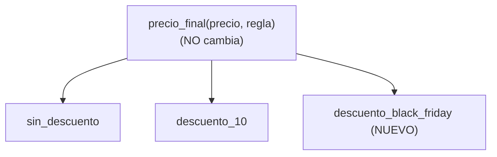

# Lección 14 — OCP (Open/Closed Principle)

> Fase 0 · SOLID · micro-paso · concepto nuevo: **extender sin modificar**.

## 0. 🧭 La pregunta
> *"Cada descuento nuevo me obliga a editar la función de precios y meter otro `if`.
> ¿Cómo agrego comportamientos sin tocar lo que ya funciona?"*

## 1. Objetivo
Diseñar código **abierto a extensión** y **cerrado a modificación**.

## 2. Cita de la fuente
> *"...open for extension but closed for modification..."* — Cap. 1 (SOLID)

## 3. El dolor / necesidad
Editar código estable para cada caso nuevo arriesga romper lo que ya andaba.

## 4. Explicación paso a paso
1. OCP = abierto a extensión, cerrado a modificación.
2. Cada descuento es una función independiente.
3. `precio_final(precio, regla)` recibe la regla como dato; no sabe cuáles existen.
4. Agregar `descuento_black_friday` no toca `precio_final`: solo suma una función.

Ver [`ocp.py`](ocp.py). Ejecutar:
```bash
uv run python lecciones/14-ocp/ocp.py
```

## 5. Diagrama (Mermaid)

El núcleo queda cerrado; el sistema queda abierto a nuevas reglas enchufables.

## 6. Árbol de archivos
```
lecciones/14-ocp/
├── README.md
└── ocp.py
```

## 7. Tu turno
Agrega `descuento_cliente_vip(precio)` (30%) sin modificar `precio_final`.

## 8. Comprobación
Se comprueba ejecutando; opcionalmente pytest por cada regla.

## 9. Preguntas de recuerdo
1. ¿Qué significa "abierto a extensión, cerrado a modificación"?
2. ¿Por qué `precio_final` no cambia al agregar descuentos?
3. ¿Qué riesgo evita el OCP?
