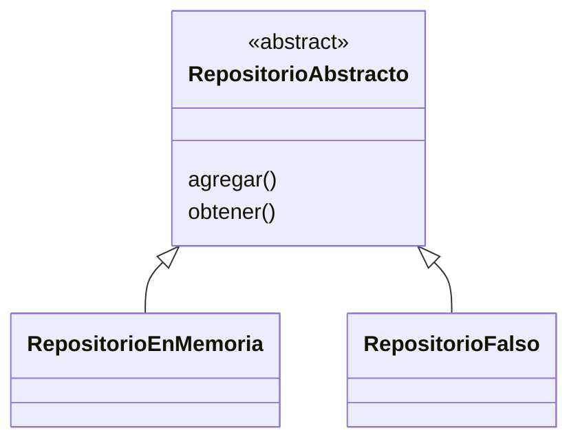

# Lección 15 — LSP (Liskov Substitution Principle)

> Fase 0 · SOLID · micro-paso · concepto nuevo: **subtipos intercambiables**.

## 0. 🧭 La pregunta
> *"Quiero un repositorio falso para pruebas en lugar del real, y que el código no
> note la diferencia. ¿Cómo garantizo que el falso se use en lugar del real?"*

## 1. Objetivo
Entender que una subclase debe poder sustituir a su base sin romper nada.

## 2. Cita de la fuente
> *"class FakeRepository(AbstractRepository):"* — Cap. 2

El libro sustituye el repositorio real por un falso en las pruebas.

## 3. El dolor / necesidad
Si el falso no se comporta como el real, las pruebas mienten y el código se rompe al cambiar.

## 4. Explicación paso a paso
1. LSP = la subclase se usa en lugar de la base sin romper el comportamiento.
2. `RepositorioEnMemoria` y `RepositorioFalso` cumplen el mismo contrato.
3. `guardar_y_leer(repo, ref)` funciona con cualquiera.
4. Ambos dan el mismo resultado: son intercambiables.

Ver [`lsp.py`](lsp.py). Ejecutar:
```bash
uv run python lecciones/15-lsp/lsp.py
```

## 5. Diagrama (Mermaid)

Donde se espera la base, cualquiera de las dos implementaciones encaja.

## 6. Árbol de archivos
```
lecciones/15-lsp/
├── README.md
└── lsp.py
```

## 7. Tu turno
Crea `RepositorioLista(RepositorioAbstracto)` y pásalo a `guardar_y_leer`: debe dar lo mismo.

## 8. Comprobación
Se comprueba ejecutando; opcionalmente pytest usando el repositorio falso.

## 9. Preguntas de recuerdo
1. ¿Qué dice el LSP?
2. ¿Por qué un falso debe comportarse como el real?
3. ¿Cómo ayuda el LSP a las pruebas?
