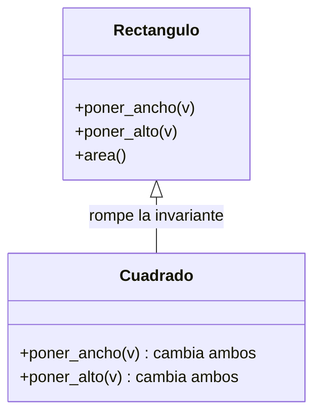
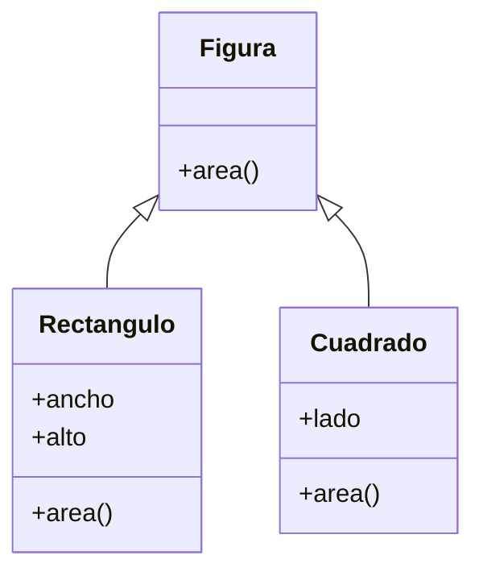

# Lección 15 — LSP (Liskov Substitution Principle)

> Fase 0 · Formulario · SOLID · Familia de concepto: **subtipos intercambiables** · Orden de estudio: **16 de 18**

⬅️ [Lección 14 · OCP](../14-ocp/) · 🏠 [Índice de lecciones](../README.md) · ➡️ [Lección 16 · ISP](../16-isp/)

---

## 🧭 Ruta de estudio · Lección 15 (≈ 1.5 h)

**Antes necesitas:** [Lección 10 · Herencia](../10-herencia/) (madre/hija, `super()`) y [Lección 14 · OCP](../14-ocp/) (extender con subclases).

| Paso | Qué haces | Dónde | ⏱ |
|:-:|---|---|:-:|
| **0** | Lee la teoría, las reglas del contrato, el diagnóstico, las propiedades y los errores | este README §0–§8 | 20 min |
| **1** | Ejecuta las reglas y mira dónde una hija **rompe** a quien usa la madre | [`paso1_formulas.py`](paso1_formulas.py) | 10 min |
| **2** | Sigue los ejemplos resueltos (pingüino, cuadrado, test de contrato) | §9 + [`paso2_ejemplos_resueltos.py`](paso2_ejemplos_resueltos.py) | 15 min |
| **3** | Corre los tests (salen en **rojo**) y completa los `# TODO` hasta verlos en **verde** | [`paso3_tu_turno.py`](paso3_tu_turno.py) + [`test_paso3_tu_turno.py`](test_paso3_tu_turno.py) | 20 min |
| **4** | Compara con la solución de referencia | [`paso4_tu_turno_solucion.py`](paso4_tu_turno_solucion.py) | 5 min |
| **5** | Resuelve los 12 problemas, luego revisa claves y solucionario | §10–§11 + [`paso5_solucionario/`](paso5_solucionario/) | 20 min |
| **6** | Compara solución mala vs buena | [`paso6_ejercicios/`](paso6_ejercicios/) | 10 min |
| **7** | Responde las preguntas de recuerdo **sin mirar** | §15 | 5 min |
| **🚦** | Evalúa si puedes pasar a la siguiente | §16 | 1 min |

---

## 0. 🧭 La pregunta
> *"Quiero un repositorio falso para pruebas en lugar del real, y que el código no
> note la diferencia. ¿Cómo garantizo que el falso se use en lugar del real?"*

## 1. Objetivos (al terminar podrás…)
1. Explicar el LSP: una **hija** debe poder **sustituir** a su **madre** sin romper nada.
2. Revisar el **contrato** de una clase: firma, tipo de respuesta, lo que exige y lo que promete.
3. Reconocer las violaciones clásicas: el **pingüino que no vuela** y el **cuadrado-rectángulo**.
4. Escribir un **test de contrato** que sirva para el repositorio real **y** para el falso.

## 2. Cita de la fuente
> *"SOLID is an acronym for Robert C. Martin's five principles of object-oriented design:
> single responsibility, open for extension but closed for modification, Liskov
> substitution, interface segregation, and dependency inversion."* — Introducción (nota 2)

> *"Here's one of the biggest benefits of the Repository pattern: A simple fake repository
> using a set (repository.py) class FakeRepository(AbstractRepository):"* — Cap. 2

> *"Python will refuse to let you instantiate a class that does not implement all the
> abstractmethods defined in its parent class."* — Cap. 2

**Por qué importa:** todo el libro prueba la lógica con un `FakeRepository` **en lugar del**
repositorio real. Eso solo funciona si el falso **cumple el mismo contrato** que el real: eso es
el LSP. Ojo con la última cita: la ABC te obliga a **tener** los métodos, pero no a que se
**comporten** igual. Eso lo comprueban los tests.

## 3. El dolor
```python
class Rectangulo:
    def poner_ancho(self, v): self.ancho = v
    def poner_alto(self, v): self.alto = v
    def area(self): return self.ancho * self.alto

class Cuadrado(Rectangulo):          # "un cuadrado ES UN rectángulo"… ¿seguro?
    def poner_ancho(self, v): self.ancho = v; self.alto = v
    def poner_alto(self, v): self.ancho = v; self.alto = v

def agrandar(r):                     # escrita pensando en Rectangulo
    r.poner_ancho(5)
    r.poner_alto(4)
    return r.area()                  # espera 20…

agrandar(Cuadrado(1))                # ¡da 16!
```
El código **funciona con la madre y falla con la hija**. Si eso pasa con tu falso de pruebas,
tus tests **mienten**: pasan con el falso y el sistema real se rompe.

---

## 4. 📘 Teoría

> **🎯 Definición — LSP (Principio de Sustitución de Liskov)**
> Si un código funciona con una clase **madre**, debe funcionar **igual** con **cualquier hija**,
> sin saber cuál recibió y sin llevarse sorpresas.
> "Igual" no es "da el mismo número"; es "**cumple las mismas promesas**".

> **📜 El contrato de una clase (lo que una hija debe respetar)**
>
> | Parte del contrato | Pregunta | Regla para la hija |
> |---|---|---|
> | **Firma** | ¿qué métodos y qué parámetros tiene? | los **mismos** |
> | **Respuesta** | ¿qué tipo de dato devuelve? | el **mismo** tipo |
> | **Precondición** | ¿qué exige para funcionar? | **no exigir más** |
> | **Postcondición** | ¿qué promete al terminar? | **no prometer menos** |
> | **Errores** | ¿qué errores puede lanzar? | **no** lanzar errores **nuevos** |
> | **Invariante** | ¿qué es siempre cierto (p. ej. "ancho y alto son independientes")? | **respetarlo** |

> **🔤 Vocabulario**
> - **Sustituir:** usar una hija donde se esperaba la madre.
> - **Contrato:** el conjunto de promesas de una clase (la tabla de arriba).
> - **Precondición / postcondición:** lo que un método **pide** antes / **garantiza** después.
> - **Invariante:** algo que siempre debe ser cierto en el objeto.
> - **Test de contrato:** **un** test que se corre contra **todas** las implementaciones.
> - **`set`:** colección sin repetidos (`set()`, `.add(x)`, `x in s`); el libro la usa en su `FakeRepository`.

> **🧠 Regla de oro**
> Si tu función necesita preguntar `isinstance(x, Hija)` para tratarla distinto, esa hija
> **no cumple** el LSP.

---

## 5. 🧮 Formulario: reglas del contrato (LSP)
| # | Síntoma / olor | Regla | Plantilla de código | Qué logra |
|---|---|---|---|---|
| LS1 | La hija cambia el **nombre** o los **parámetros** del método | **Misma firma** | `def obtener(self, ref):` en madre **y** en hija | Se llama igual en ambas |
| LS2 | La hija devuelve **otro tipo** (lista en vez de texto) | **Mismo tipo** de respuesta | madre `-> str`, hija `-> str` | Quien usa el resultado no se rompe |
| LS3 | La hija **rechaza** entradas que la madre aceptaba | **No exigir más** | si la madre acepta cualquier `ref`, la hija también | Funciona con los mismos datos |
| LS4 | La hija **no cumple** lo que la madre prometía | **No prometer menos** | "lo agregado se puede obtener; lo demás da `None`" | Los resultados son confiables |
| LS5 | La hija lanza `NotImplementedError` u otro error **nuevo** | **No errores nuevos** | separar la jerarquía: `Ave` → `AveVoladora` | Nadie se lleva sorpresas |
| LS6 | La hija rompe una **invariante** (cuadrado-rectángulo) | **Respetar invariantes** | hacerlas **hermanas**: `Figura` → `Rectangulo`, `Cuadrado` | La función de la madre sigue valiendo |

> 💡 Todas las reglas están ejecutables en [`paso1_formulas.py`](paso1_formulas.py), con su
> código (LS1…LS6) en cada línea de salida. Ahí verás `16` donde se esperaba `20`.

## 6. 🔍 Diagnóstico: ¿esta hija viola el LSP?
| # | Pregunta | Si respondes… | …entonces |
|---|---|---|---|
| G1 | ¿Alguna función hace `isinstance` para tratar distinto a esta hija? | Sí | La hija no es sustituible → regla de oro |
| G2 | ¿La hija lanza `NotImplementedError` o un error que la madre no lanzaba? | Sí | Viola LS5 → separa la jerarquía |
| G3 | ¿Cambió parámetros, ignora alguno o devuelve otro tipo? | Sí | Viola LS1 / LS2 |
| G4 | Un test escrito para la **madre**, ¿falla con la **hija**? | Sí | Viola LS4 o LS6 |
| G5 | ¿El **falso** de pruebas se comporta distinto que el **real**? | Sí | Tus tests mienten → test de contrato |
| G6 | ¿La hija "es un" la madre solo en el **nombre** (o en la vida real), pero no en el **comportamiento**? | Sí | Probable LS6 → hermanas |

## 7. 📐 Propiedades y consecuencias
| # | Propiedad |
|---|---|
| **P1** | Si se cumple el LSP, el código de alto nivel **no necesita saber** qué hija recibió. |
| **P2** | El contrato es de **comportamiento**, no solo de nombres de métodos. |
| **P3** | Es lo que permite usar **falsos** en los tests (el `FakeRepository` del cap. 2). |
| **P4** | Heredar **no garantiza** el LSP: la herencia solo copia métodos, no promesas. |
| **P5** | Un **test de contrato** (el mismo test para todas las implementaciones) es la mejor forma de verificarlo. |
| **P6** | Una ABC obliga a que **existan** los métodos; **no** obliga a que se **comporten** igual. |

## 8. ⚠️ Errores frecuentes
| # | ❌ Así no | Qué pasa | ✅ Así sí |
|---|---|---|---|
| E1 | `class Cuadrado(Rectangulo)` que cambia ancho y alto a la vez | `agrandar(Cuadrado(1))` da `16` en vez de `20`; un `assert … == 20` lanza `AssertionError` | Hazlas **hermanas** de `Figura` (LS6) |
| E2 | `class Pinguino(Ave)` con `volar()` que lanza `NotImplementedError` | Quien recorre aves para hacerlas volar se cae: `NotImplementedError: los pingüinos no vuelan` | Separa: `Ave` (comer) y `AveVoladora` (volar) |
| E3 | Un falso que devuelve **otro tipo** (una lista en vez del texto) | El test pasa o falla por la razón equivocada | Mismo tipo que el real (LS2) |
| E4 | Cambiar la firma en la hija: `def obtener(self):` | `TypeError: RepoRoto.obtener() takes 1 positional argument but 2 were given` | La misma firma: `def obtener(self, ref):` |
| E5 | "Parchar" con `if isinstance(x, Pinguino): …` en el código que usa aves | Rompe también el OCP: cada hija rara agrega otro `if` | Arregla la **jerarquía**, no a quien la usa |
| E6 | Creer que la ABC garantiza el LSP | Un falso "con trampa" pasa la ABC y aun así miente | Escribe un **test de contrato** (Ejemplo 4) |

> 🔬 Pruébalos: al final de [`paso1_formulas.py`](paso1_formulas.py) están E1 y E4
> comentados. Quita el `#` de **un** bloque, ejecuta, lee el mensaje y vuelve a ponerlo.

---

## 9. ✍️ Ejemplos resueltos
> Todos están en [`paso2_ejemplos_resueltos.py`](paso2_ejemplos_resueltos.py).

**Ejemplo 1 — Dos repositorios intercambiables** *(fácil)*
> Enunciado: escribe una función de alto nivel que funcione con **cualquier** repositorio que
> cumpla el contrato `agregar(ref)` / `obtener(ref)`.
```python
from abc import ABC, abstractmethod

# Paso 1: el contrato (la madre abstracta).
class RepositorioAbstracto(ABC):
    @abstractmethod
    def agregar(self, ref): ...
    @abstractmethod
    def obtener(self, ref): ...

# Paso 2: dos hijas que cumplen el MISMO contrato (guardan distinto por dentro).
class RepositorioEnMemoria(RepositorioAbstracto):
    def __init__(self): self._datos = {}
    def agregar(self, ref): self._datos[ref] = ref
    def obtener(self, ref): return self._datos.get(ref)

class RepositorioFalso(RepositorioAbstracto):
    def __init__(self): self._datos = set()
    def agregar(self, ref): self._datos.add(ref)
    def obtener(self, ref): return ref if ref in self._datos else None

# Paso 3: la función escrita para la madre funciona igual con las dos.
def guardar_y_leer(repo, ref):
    repo.agregar(ref)
    return repo.obtener(ref)

print(guardar_y_leer(RepositorioEnMemoria(), "LOTE-001"))   # -> LOTE-001
print(guardar_y_leer(RepositorioFalso(), "LOTE-001"))       # -> LOTE-001
```
`ref if ref in self._datos else None` es un `if` en una línea: "da `ref` si está; si no, `None`".

**Ejemplo 2 — El pingüino que no vuela** *(fácil)*
> Enunciado: `Pinguino(Ave)` hereda `volar()` pero lanza un error. Arregla la jerarquía.
```python
# Paso 1 (violación): la hija lanza un error que la madre no lanzaba (LS5).
class AveMala:
    def volar(self): return "vuela"

class PinguinoMalo(AveMala):
    def volar(self): raise NotImplementedError("los pingüinos no vuelan")

# -> vuela / ROMPE: los pingüinos no vuelan

# Paso 2 (refactor): la madre solo promete lo que TODAS cumplen.
class Ave:
    def comer(self): return "come"

class AveVoladora(Ave):
    def volar(self): return "vuela"

class Pato(AveVoladora):
    pass

class Pinguino(Ave):                 # ya no promete volar
    def nadar(self): return "nada"

# Paso 3 (uso): quien necesita volar pide AveVoladora.
for ave in [Pato(), Pinguino()]:
    print(type(ave).__name__, "->", ave.comer())   # -> Pato -> come / Pinguino -> come
```

**Ejemplo 3 — Rectángulo y Cuadrado** *(intermedio)*
> Enunciado: `Cuadrado(Rectangulo)` rompe `agrandar`. Muestra el fallo y arréglalo.
```python
# Paso 1 (violación, LS6): ver §3. agrandar(RectanguloMalo(1, 1)) -> 20, agrandar(CuadradoMalo(1)) -> 16

# Paso 2 (refactor): HERMANAS, no madre e hija. Comparten solo lo que ambas cumplen: area().
class Figura:
    def area(self): return 0

class Rectangulo(Figura):
    def __init__(self, ancho, alto):
        self.ancho = ancho
        self.alto = alto
    def area(self): return self.ancho * self.alto

class Cuadrado(Figura):
    def __init__(self, lado):
        self.lado = lado
    def area(self): return self.lado * self.lado

# Paso 3 (uso): cualquier Figura sirve donde se espera una Figura.
def area_total(figuras):
    total = 0
    for figura in figuras:
        total = total + figura.area()
    return total

print("Área total:", area_total([Rectangulo(5, 4), Cuadrado(3)]))   # -> 29
```

**Ejemplo 4 — Un test de contrato para el real y el falso, como en el cap. 2** *(avanzado)*
> Enunciado: escribe **un solo** test que cualquier repositorio deba pasar, y úsalo para
> descubrir un falso "con trampa".
```python
# Paso 1: UNA función de prueba que describe el contrato.
def probar_contrato(repo):
    repo.agregar("L1")
    assert repo.obtener("L1") == "L1", "lo agregado se debe poder obtener"
    assert repo.obtener("NO-EXISTE") is None, "lo no agregado debe dar None"
    return "OK"

# Paso 2: la pasamos a cada implementación.
print("RepositorioEnMemoria:", probar_contrato(RepositorioEnMemoria()))   # -> OK
print("RepositorioFalso    :", probar_contrato(RepositorioFalso()))       # -> OK

# Paso 3: un falso que guarda en minúsculas NO cumple el contrato.
class RepositorioFalsoConTrampa(RepositorioAbstracto):
    def __init__(self): self._datos = set()
    def agregar(self, ref): self._datos.add(ref.lower())
    def obtener(self, ref): return ref if ref in self._datos else None

try:
    probar_contrato(RepositorioFalsoConTrampa())
except AssertionError as error:
    print("RepositorioFalsoConTrampa: FALLA ->", error)   # -> lo agregado se debe poder obtener
```
El falso con trampa **sí** hereda de la ABC (Python lo deja crear), pero **no** cumple el
contrato. Solo el test lo descubre (P6).

---

## 10. 📝 Problemas propuestos
> Resuélvelos **antes** de mirar las claves. Puedes crear tu propio archivo
> (`mis_problemas.py`) en esta carpeta.

**🟢 Nivel básico**
1. Explica el LSP en una frase.
2. Con `Animal.hablar()` y las hijas `Perro` (`"guau"`) y `Gato` (`"miau"`), escribe
   `describir(animal)` que devuelva `"dice …"`. ¿Funciona con ambas sin preguntar el tipo?
3. ¿Cumple el LSP una hija que lanza `NotImplementedError` en un método heredado? ¿Por qué?
4. El repositorio real devuelve `None` si la referencia no existe. Escribe un falso que haga
   **lo mismo** y muestra `obtener("X")` en ambos.

**🟡 Nivel intermedio**

5. `CuentaSinRetiro(Cuenta)` lanza un error en `retirar()`. Rediseña: `Cuenta` (depositar),
   `CuentaConRetiro` y `CuentaPlazoFijo`. Deposita 100 y retira 30 en una; deposita 500 en la otra.
6. Muestra con números el fallo de `Cuadrado(Rectangulo)` usando `agrandar` (ancho 5, alto 4).
7. La hija `RepoRoto` define `obtener(self)` sin `ref`. ¿Qué error sale al llamar
   `RepoRoto().obtener("L1")`? Corrígelo.
8. Escribe `probar_contrato(repo)` y pásaselo a un repositorio con `dict` y a otro con `set`.

**🔴 Nivel avanzado**

9. Un repositorio "con trampa" guarda las referencias en minúsculas. Usa tu test de contrato
   (con `"Lote-A"`) para descubrirlo.
10. `Notificador.enviar()` promete devolver `True` si envió. Escribe un falso **malo** (devuelve
    `None`) y uno **bueno** (guarda el mensaje y devuelve `True`). ¿Qué hace
    `avisar(notificador, msg)` (que usa `if notificador.enviar(msg):`) con cada uno?
11. Reemplaza esta cadena de `isinstance` por un método `pago()` en cada clase:
    `if isinstance(e, Gerente): total += e.sueldo + 500 else: total += e.sueldo`.
    Prueba con `Empleado(1000)` y `Gerente(2000)`.
12. *(Puente al libro)* Escribe `AbstractRepository` (`add`, `get`), un `RepositorioDict` y un
    `FakeRepository` que guarde en un `set` (como en el cap. 2). Comprueba que
    `cantidad_de(repo, "lote-1")` da lo mismo con los dos.

## 11. 🔑 Claves (respuestas)
<details><summary>Ver claves (solo después de intentarlo)</summary>

| # | Respuesta / salida esperada | Regla / idea |
|---|---|---|
| 1 | Si el código funciona con la madre, debe funcionar **igual** con cualquier hija | §4 |
| 2 | `dice guau` / `dice miau`; **sí**, sin preguntar el tipo | P1 |
| 3 | **No**: lanza un error que la madre no lanzaba | LS5 |
| 4 | `None None` | LS4 |
| 5 | saldos `70 500`; `CuentaPlazoFijo` no tiene `retirar` (`False`) | LS5 |
| 6 | esperado `20`; `Rectangulo: 20`, `Cuadrado: 16` | LS6 |
| 7 | `RepoRoto.obtener() takes 1 positional argument but 2 were given`; con `def obtener(self, ref)` → `L1` | LS1 |
| 8 | `OK OK` | test de contrato |
| 9 | `RepoBueno -> OK` / `RepoConTrampa -> FALLA: lo agregado se debe poder obtener` | E6 |
| 10 | real `avisado` · falso malo `NO avisado` · falso bueno `avisado ['hola']` | LS4 |
| 11 | `3500 3500` (antes y después dan lo mismo, pero sin `isinstance`) | regla de oro |
| 12 | `20 20` | P3 + cap. 2 |

En el problema 12, `next(l for l in self._lotes if l.referencia == referencia)` (como en el
libro) significa: "el **primer** lote que cumpla la condición".

El código completo de cada solución está en [`paso5_solucionario/`](paso5_solucionario/):
[`nivel_basico.py`](paso5_solucionario/nivel_basico.py) ·
[`nivel_intermedio.py`](paso5_solucionario/nivel_intermedio.py) ·
[`nivel_avanzado.py`](paso5_solucionario/nivel_avanzado.py).
</details>

---

## 12. 🗺️ Diagrama antes / después (Mermaid)
**Antes** — la hija no puede sustituir a la madre:

**Después** — hermanas que cumplen el mismo contrato:

**Cómo leerlo:** antes, `Cuadrado` hereda de `Rectangulo` pero cambia el sentido de `poner_ancho`
y `poner_alto`: quien esperaba un rectángulo se lleva una sorpresa. Después, ambas son **hijas de
`Figura`**, que solo promete `area()`, una promesa que las dos cumplen. Así cualquiera de las dos
puede sustituir a `Figura`.

## 13. 🌳 Árbol de archivos
```
lecciones/15-lsp/
├── README.md                    ← PASO 0 · EMPIEZA AQUÍ (este formulario)
├── paso1_formulas.py            ← PASO 1 · las reglas LS1–LS6, ejecutables
├── paso2_ejemplos_resueltos.py  ← PASO 2 · los 4 ejemplos resueltos
├── paso3_tu_turno.py            ← PASO 3 · completa los # TODO
├── test_paso3_tu_turno.py       ← PASO 3 · los tests (rojo → verde)
├── paso4_tu_turno_solucion.py   ← PASO 4 · solución de referencia
├── paso5_solucionario/          ← PASO 5 · soluciones de los 12 problemas
│   ├── nivel_basico.py
│   ├── nivel_intermedio.py
│   └── nivel_avanzado.py
└── paso6_ejercicios/            ← PASO 6 · solución mala vs buena
    ├── ejercicio-1/ … ejercicio-3/
    └── ejercicio-4-reto/
```

## 14. 🤝 Tu turno y ✅ comprobación con pytest
La comprobación es con **pytest**, al estilo **TDD**: los tests ya están escritos y
**empiezan en rojo a propósito**. Completa los `# TODO` de [`paso3_tu_turno.py`](paso3_tu_turno.py)
hasta que pasen a **verde**.
```bash
uv run pytest lecciones/15-lsp -q
# al empezar: 3 failed, 2 passed   (rojo: falta tu código)
# al terminar: 5 passed            (verde)
```
Fíjate en `probar_contrato` dentro de [`test_paso3_tu_turno.py`](test_paso3_tu_turno.py): es un
**test de contrato**. El mismo test se corre contra la referencia **y** contra tu
`RepositorioLista`. Si los dos pasan, son intercambiables.

Para comparar con la referencia:
```bash
git diff --no-index lecciones/15-lsp/paso3_tu_turno.py lecciones/15-lsp/paso4_tu_turno_solucion.py
```

## 15. ❓ Preguntas de recuerdo
> Respóndelas **sin mirar**; luego abre cada una para comprobar.

<details><summary>1. ¿Qué dice el LSP?</summary>

Que una hija debe poder **sustituir** a su madre: el código que funciona con la madre debe
funcionar igual con cualquier hija.
</details>
<details><summary>2. ¿Por qué <code>Cuadrado(Rectangulo)</code> viola el LSP?</summary>

Porque rompe una invariante de la madre (ancho y alto independientes): `agrandar` espera 20 y obtiene 16.
</details>
<details><summary>3. ¿Por qué el falso de pruebas debe comportarse como el real?</summary>

Porque si no, los tests **mienten**: pasan con el falso y el sistema real falla.
</details>
<details><summary>4. ¿Una ABC garantiza el LSP?</summary>

**No.** Obliga a que los métodos **existan**, no a que se **comporten** igual. Eso lo comprueba un test de contrato.
</details>
<details><summary>5. ¿Qué señal en el código delata una violación del LSP?</summary>

Un `isinstance(x, Hija)` para tratar distinto a una hija (o una hija que lanza `NotImplementedError`).
</details>
<details><summary>6. ¿Qué es un test de contrato?</summary>

Un **mismo** test que se corre contra **todas** las implementaciones (real, falsa…) para comprobar que cumplen las mismas promesas.
</details>

---

## 16. 🚦 ¿Puedo pasar a la siguiente lección?
| Indicador | Criterio |
|:-:|---|
| 🟢 **Sí, sigue** | `uv run pytest lecciones/15-lsp -q` sale en **verde** (5 passed) **y** aciertas **≥ 9 de 12** problemas **y** respondes las 6 preguntas sin mirar |
| 🟡 **Repasa** | aciertas **6 a 8** → vuelve a §8 (errores frecuentes) y §9 (ejemplos resueltos) y reintenta los que fallaste |
| 🔴 **Repite la lección** | aciertas **menos de 6** → empieza otra vez desde el Paso 0 |

Cuando estés en 🟢, marca la lección en
[`progreso/fase-0-python.md`](../../progreso/fase-0-python.md) (sección *"Mi avance"*) y haz
commit; así también practicas Git.

---

⬅️ [Lección 14 · OCP](../14-ocp/) · 🏠 [Índice de lecciones](../README.md) · ➡️ [Lección 16 · ISP](../16-isp/)
