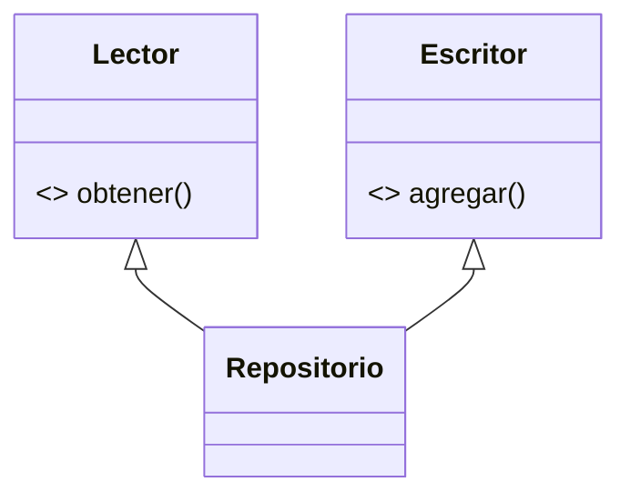

# Lección 16 — ISP (Interface Segregation Principle)

> Fase 0 · SOLID · micro-paso · concepto nuevo: **interfaces pequeñas**.

## 0. 🧭 La pregunta
> *"Mi reporte solo lee, pero depende de una interfaz gigante con métodos que no
> usa. ¿Cómo evito depender de lo que no necesito?"*

## 1. Objetivo
Separar interfaces grandes en pequeñas y específicas.

## 2. Cita de la fuente
> *"To a Pythonista, a repository is any object that has add(thing) and get(id) methods."*
> — Cap. 2

Interfaces mínimas: solo lo necesario.

## 3. El dolor / necesidad
Depender de métodos que no usas te acopla a cambios que no te incumben.

## 4. Explicación paso a paso
1. ISP = interfaces pequeñas; nadie depende de lo que no usa.
2. Separar `Lector` (obtener) y `Escritor` (agregar).
3. `Repositorio(Lector, Escritor)` cumple ambas porque las necesita.
4. `reporte(lector: Lector, ...)` depende solo de `Lector`.

Ver [`isp.py`](isp.py). Ejecutar:
```bash
uv run python lecciones/16-isp/isp.py
```

## 5. Diagrama (Mermaid)

Cada consumidor depende solo de la interfaz pequeña que necesita.

## 6. Árbol de archivos
```
lecciones/16-isp/
├── README.md
└── isp.py
```

## 7. Tu turno
Escribe una función `respaldo(escritor: Escritor, ref)` que solo dependa de `Escritor`.

## 8. Comprobación
Se comprueba ejecutando; opcionalmente pytest de `reporte`.

## 9. Preguntas de recuerdo
1. ¿Qué dice el ISP?
2. ¿Por qué separar `Lector` y `Escritor`?
3. ¿De qué interfaz depende `reporte` y por qué solo esa?
