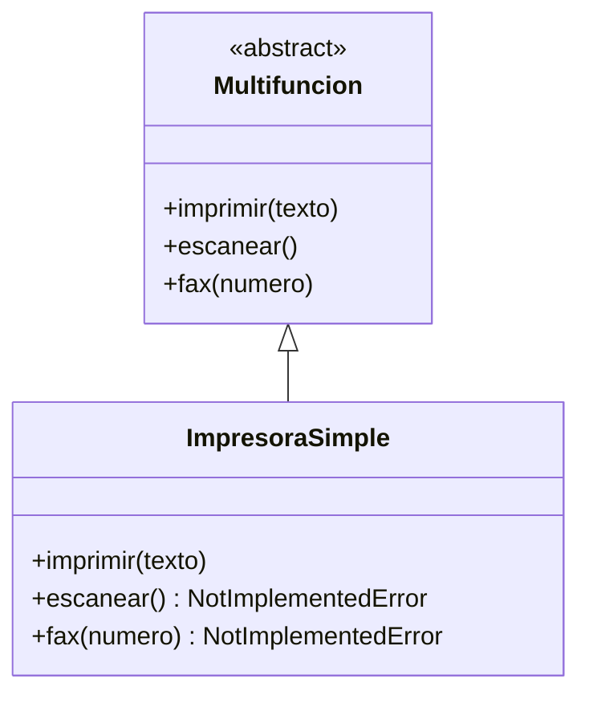
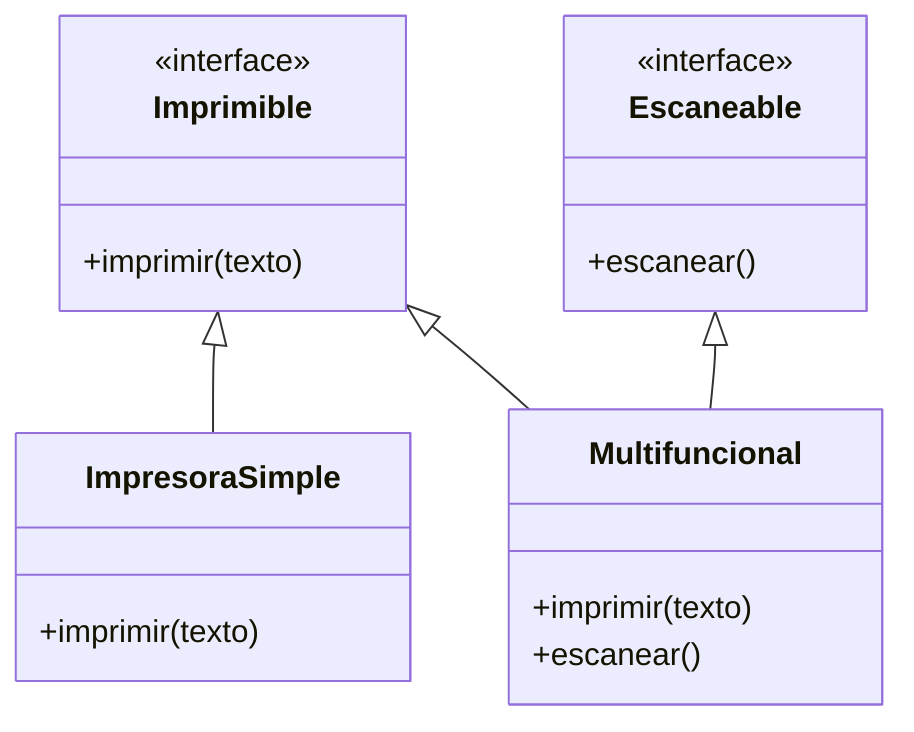

# Lección 16 — ISP (Interface Segregation Principle)

> Fase 0 · Formulario · SOLID · Familia de concepto: **interfaces pequeñas, por rol** · Orden de estudio: **17 de 18**

⬅️ [Lección 15 · LSP](../15-lsp/) · 🏠 [Índice de lecciones](../README.md) · ➡️ [Lección 17 · DIP](../17-dip/)

---

## 🧭 Ruta de estudio · Lección 16 (≈ 1.5 h)

**Antes necesitas:** [Lección 12 · Abstracción](../12-abstraccion/) (`ABC`, `@abstractmethod`) y [Lección 15 · LSP](../15-lsp/) (contratos e hijas intercambiables).

| Paso | Qué haces | Dónde | ⏱ |
|:-:|---|---|:-:|
| **0** | Lee la teoría, las recetas, el diagnóstico, las propiedades y los errores | este README §0–§8 | 20 min |
| **1** | Ejecuta las recetas: interfaz gorda → interfaces por rol | [`paso1_formulas.py`](paso1_formulas.py) | 10 min |
| **2** | Sigue los ejemplos resueltos (multifunción, falso mínimo, duck typing) | §9 + [`paso2_ejemplos_resueltos.py`](paso2_ejemplos_resueltos.py) | 15 min |
| **3** | Corre los tests (salen en **rojo**) y completa los `# TODO` hasta verlos en **verde** | [`paso3_tu_turno.py`](paso3_tu_turno.py) + [`test_paso3_tu_turno.py`](test_paso3_tu_turno.py) | 20 min |
| **4** | Compara con la solución de referencia | [`paso4_tu_turno_solucion.py`](paso4_tu_turno_solucion.py) | 5 min |
| **5** | Resuelve los 12 problemas, luego revisa claves y solucionario | §10–§11 + [`paso5_solucionario/`](paso5_solucionario/) | 20 min |
| **6** | Compara solución mala vs buena | [`paso6_ejercicios/`](paso6_ejercicios/) | 10 min |
| **7** | Responde las preguntas de recuerdo **sin mirar** | §15 | 5 min |
| **🚦** | Evalúa si puedes pasar a la siguiente | §16 | 1 min |

---

## 0. 🧭 La pregunta
> *"Mi reporte solo lee, pero depende de una interfaz gigante con métodos que no
> usa. ¿Cómo evito depender de lo que no necesito?"*

## 1. Objetivos (al terminar podrás…)
1. Explicar el ISP: **ningún cliente debe depender de métodos que no usa**.
2. Detectar una **interfaz gorda** por sus señales (métodos vacíos o `NotImplementedError`).
3. Partir una interfaz por **rol** y combinarlas en una clase que las necesite todas.
4. Entender el **duck typing** del libro: "un repositorio es cualquier objeto con `add` y `get`".

## 2. Cita de la fuente
> *"SOLID is an acronym for Robert C. Martin's five principles of object-oriented design:
> single responsibility, open for extension but closed for modification, Liskov
> substitution, interface segregation, and dependency inversion."* — Introducción (nota 2)

> *"In practice we often just rely on Python's duck typing to enable abstractions. To a
> Pythonista, a repository is any object that has add(thing) and get(id) methods."* — Cap. 2

> *"In Python you can (and we sometimes do) use ABCs, but you can also happily rely on duck
> typing."* — Introducción

**Por qué importa:** el `AbstractRepository` del libro tiene solo **dos** métodos (`add` y `get`).
Es una interfaz **mínima**: justo lo que necesita quien la usa. Por eso escribir un
`FakeRepository` es trivial. Con una interfaz de 20 métodos, cada falso sería un infierno.

## 3. El dolor
```python
class Multifuncion(ABC):           # una interfaz para TODAS las impresoras
    @abstractmethod
    def imprimir(self, texto): ...
    @abstractmethod
    def escanear(self): ...
    @abstractmethod
    def fax(self, numero): ...

class ImpresoraSimple(Multifuncion):
    def imprimir(self, texto): return "imprime " + texto
    def escanear(self): raise NotImplementedError("no escanea")   # ← obligada a mentir
    def fax(self, numero): raise NotImplementedError("no tiene fax")
```
La impresora simple está **obligada** a tener métodos que no puede cumplir, y todo el que la use
puede llevarse un `NotImplementedError`. Además, si cambia la firma de `fax`, hay que tocar
**todas** las impresoras, aunque casi ninguna tenga fax.

---

## 4. 📘 Teoría

> **🎯 Definición — ISP (Principio de Segregación de Interfaces)**
> **Ningún cliente debe verse obligado a depender de métodos que no usa.** Mejor varias
> interfaces **pequeñas y específicas** (una por **rol**) que una grande para todo.

> **🧩 Interfaz, cliente y rol**
>
> | Palabra | Qué es | Ejemplo |
> |---|---|---|
> | **Interfaz** | el conjunto de métodos que se promete tener | `Lector` con `obtener()` |
> | **Cliente** | el código que **usa** esa interfaz | `reporte(lector, ref)` |
> | **Rol** | lo que el cliente necesita que el objeto **haga** | "leer", "escribir", "imprimir" |
>
> El ISP mira desde el lado del **cliente**: ¿qué necesita **él**?

> **🔤 Vocabulario**
> - **Interfaz gorda:** una interfaz con muchos métodos de roles distintos.
> - **Segregar:** separar en partes.
> - **Herencia de varias ABC:** `class Repositorio(Lector, Escritor):` cumple las dos.
> - **Duck typing:** "si camina como pato y hace cuac, es un pato": en Python basta con que el
>   objeto **tenga** el método que se llama, herede o no de una ABC.
> - **Falso mínimo:** un objeto de prueba con **solo** los métodos que el código probado usa.

> **🧠 Regla de oro**
> Pregunta qué necesita **el que USA** la interfaz, no qué **puede hacer** el que la implementa.

---

## 5. 🧮 Formulario: recetas ISP
| # | Síntoma / olor | Regla | Plantilla de código | Qué logra |
|---|---|---|---|---|
| I1 | Una interfaz **gorda** (muchos métodos, varios roles) | **Parte por rol** | `class Lector(ABC): obtener` · `class Escritor(ABC): agregar` | Cada cliente ve solo su parte |
| I2 | Implementaciones con `pass` o `NotImplementedError` "porque no aplica" | Es la **señal** de I1: separa | `class ImpresoraSimple(Imprimible)` | Nadie promete lo que no cumple |
| I3 | Una clase que **sí** necesita varios roles | **Hereda de varias** ABC pequeñas | `class Repositorio(Lector, Escritor):` | Cumple solo lo que necesita |
| I4 | El cliente pide la interfaz **grande** aunque solo lee | El cliente declara la **mínima** | `def reporte(lector: Lector, ref):` | Menos acoplamiento |
| I5 | Obligar a heredar de una ABC solo para "entrar" | **Duck typing**: basta con tener el método | cualquier objeto con `obtener()` sirve | Flexibilidad (cap. 2) |
| I6 | Tests con falsos llenos de métodos que nunca se llaman | **Falso mínimo** por rol | `class LectorFalso(Lector): def obtener(...)` | Tests cortos y claros |

> 💡 Todas las recetas están ejecutables en [`paso1_formulas.py`](paso1_formulas.py), con su
> código (I1…I6) en cada línea de salida.

## 6. 🔍 Diagnóstico: ¿esta interfaz viola el ISP?
| # | Pregunta | Si respondes… | …entonces |
|---|---|---|---|
| G1 | ¿Alguna clase implementa un método con `pass` o lanzando un error porque "no aplica"? | Sí | Interfaz gorda → I1, I2 |
| G2 | ¿El cliente usa solo **1 o 2** de los muchos métodos de la interfaz? | Sí | Que pida una interfaz mínima → I4 |
| G3 | ¿Un cambio en un método que **no uso** me obliga a cambiar o re-probar mi código? | Sí | Acoplamiento innecesario → I1 |
| G4 | Para un test, ¿tengo que fabricar un falso con métodos que **nunca** se llaman? | Sí | → I6 |
| G5 | ¿La interfaz mezcla verbos de roles distintos (leer, imprimir, enviar)? | Sí | Parte por rol → I1 |
| G6 | ¿Partí tanto que cada interfaz tiene 1 método aunque **siempre** se usan juntos? | Sí | Te pasaste: agrupa (E2) |

## 7. 📐 Propiedades y consecuencias
| # | Propiedad |
|---|---|
| **P1** | Interfaces por **rol**: cada cliente depende solo de lo que usa. |
| **P2** | Los **falsos** para tests son pequeños y fáciles de escribir. |
| **P3** | Baja el **acoplamiento**: cambiar un rol no toca a los clientes de otro. |
| **P4** | Una clase puede cumplir **varias** interfaces pequeñas a la vez. |
| **P5** | En Python el **duck typing** ya ayuda; las ABC pequeñas **documentan** el rol y avisan si falta un método. |
| **P6** | El ISP previene violaciones del **LSP**: sin métodos "que no aplican", no hay `NotImplementedError` sorpresa. |

## 8. ⚠️ Errores frecuentes
| # | ❌ Así no | Qué pasa | ✅ Así sí |
|---|---|---|---|
| E1 | Una interfaz `Multifuncion` para una impresora simple | Métodos que lanzan `NotImplementedError: no tiene fax` | Una interfaz por capacidad: `Imprimible`, `Escaneable` |
| E2 | Partir en exceso: una interfaz por cada método, aunque siempre van juntos | Fragmentación: 10 ABC para algo simple | Agrupa por **rol** (lo que un cliente usa junto) |
| E3 | Heredar de dos ABC y **olvidar** un método | `TypeError: Can't instantiate abstract class RepoIncompleto without an implementation for abstract method 'agregar'` | Implementa los métodos de **todas** las interfaces que heredas |
| E4 | El cliente pide la interfaz **grande** aunque solo lee | Depende de cambios que no le importan | El parámetro pide la **mínima**: `lector: Lector` |
| E5 | Creer que **siempre** hace falta una ABC | Burocracia innecesaria | El duck typing también vale (cita del libro); usa ABC cuando ayude a documentar |
| E6 | Falsos de test con **todos** los métodos de la interfaz real | Ruido: no se sabe qué se está probando | Falso **mínimo**: solo lo que el código probado usa |

> 🔬 Pruébalo: al final de [`paso1_formulas.py`](paso1_formulas.py) está E3 comentado. Quita el
> `#` del bloque, ejecuta, lee el mensaje y vuelve a ponerlo.

---

## 9. ✍️ Ejemplos resueltos
> Todos están en [`paso2_ejemplos_resueltos.py`](paso2_ejemplos_resueltos.py).

**Ejemplo 1 — Lector y Escritor** *(fácil)*
> Enunciado: el reporte solo lee. Haz que dependa solo de lo que usa.
```python
from abc import ABC, abstractmethod

# Paso 1: dos interfaces pequeñas en vez de una grande (receta I1).
class Lector(ABC):
    @abstractmethod
    def obtener(self, ref): ...

class Escritor(ABC):
    @abstractmethod
    def agregar(self, ref): ...

# Paso 2: el repositorio cumple ambas porque necesita ambas (receta I3).
class Repositorio(Lector, Escritor):
    def __init__(self): self._datos = {}
    def agregar(self, ref): self._datos[ref] = ref
    def obtener(self, ref): return self._datos.get(ref)

# Paso 3: el reporte solo pide un Lector (receta I4).
def reporte(lector: Lector, ref):
    return f"Encontrado: {lector.obtener(ref)}"

repo = Repositorio()
repo.agregar("LOTE-001")
print(reporte(repo, "LOTE-001"))   # -> Encontrado: LOTE-001
```
`lector: Lector` es una **anotación**: documenta qué se espera; Python no la obliga.

**Ejemplo 2 — La impresora multifunción** *(fácil)*
> Enunciado: separa la interfaz gorda de §3 para que la impresora simple no tenga que mentir.
```python
# Paso 1 (violación): ver §3. ImpresoraSimpleMala().escanear() -> ROMPE: no escanea

# Paso 2 (refactor): una interfaz por capacidad.
class Imprimible(ABC):
    @abstractmethod
    def imprimir(self, texto): ...

class Escaneable(ABC):
    @abstractmethod
    def escanear(self): ...

class ImpresoraSimple(Imprimible):                 # solo lo que tiene
    def imprimir(self, texto): return "imprime " + texto

class Multifuncional(Imprimible, Escaneable):      # la que tiene más, cumple más
    def imprimir(self, texto): return "imprime " + texto
    def escanear(self): return "escanea"

# Paso 3 (uso): cada cliente pide solo la capacidad que necesita.
def imprimir_todo(impresoras, texto):
    for impresora in impresoras:
        print(type(impresora).__name__, "->", impresora.imprimir(texto))

imprimir_todo([ImpresoraSimple(), Multifuncional()], "hola")
# -> ImpresoraSimple -> imprime hola / Multifuncional -> imprime hola
```

**Ejemplo 3 — Un falso pequeño para probar el reporte** *(intermedio)*
> Enunciado: prueba `reporte` sin fabricar métodos que nunca se usan.
```python
# Paso 1: reporte depende solo de Lector, así que el falso solo necesita obtener() (receta I6).
class LectorFalso(Lector):
    def __init__(self, datos):
        self.datos = datos
    def obtener(self, ref):
        return self.datos.get(ref)

# Paso 2: el test es corto y claro.
falso = LectorFalso({"L1": "mesa"})
assert reporte(falso, "L1") == "Encontrado: mesa"
assert reporte(falso, "NO") == "Encontrado: None"

# Paso 3: el falso tiene SOLO lo necesario.
print("¿el falso tiene agregar?", hasattr(falso, "agregar"))   # -> False
```

**Ejemplo 4 — Duck typing, como dice el cap. 2** *(avanzado)*
> Enunciado: "a repository is any object that has `add(thing)` and `get(id)` methods". Escribe
> un repositorio **sin heredar** de ninguna ABC y úsalo.
```python
# Paso 1: una clase que NO hereda de nada, pero tiene add y get (receta I5).
class AlmacenEnLista:
    def __init__(self):
        self._lotes = []
    def add(self, lote):
        self._lotes.append(lote)
    def get(self, referencia):
        for lote in self._lotes:
            if lote == referencia:
                return lote
        return None

# Paso 2: la función de alto nivel solo LLAMA add y get.
def guardar_y_confirmar(repo, lote):
    repo.add(lote)
    return repo.get(lote) == lote

# Paso 3: funciona con cualquier objeto que tenga esos dos métodos.
print("¿Guardado?", guardar_y_confirmar(AlmacenEnLista(), "lote-9"))   # -> True
print("¿Es un Lector (ABC)?", isinstance(AlmacenEnLista(), Lector))   # -> False
```
No hereda de nada y **funciona igual**: eso es duck typing. La interfaz real es "tener `add` y
`get`", y eso es todo lo que el cliente necesita.

---

## 10. 📝 Problemas propuestos
> Resuélvelos **antes** de mirar las claves. Puedes crear tu propio archivo
> (`mis_problemas.py`) en esta carpeta.

**🟢 Nivel básico**
1. Explica el ISP en una frase.
2. ¿Qué métodos usa `reporte(lector, ref)` (Ejemplo 1)?
3. Una clase tiene `def fax(self): raise NotImplementedError`. ¿De qué es señal?
4. Crea la interfaz `Imprimible` con `imprimir(texto)` y una `ImpresoraSimple` que la cumpla.
   ¿Qué da `ImpresoraSimple().imprimir("factura")`?

**🟡 Nivel intermedio**

5. `Trabajador(trabajar, comer)` obliga a un `Robot` a "comer". Pártela en `Trabajable` y
   `Alimentable`. `Humano` cumple las dos; `Robot` solo `Trabajable`. ¿El robot tiene `comer`?
6. Con `Repositorio(Lector, Escritor)`, muestra `isinstance(repo, Lector)` e
   `isinstance(repo, Escritor)`.
7. Hereda de `Lector` y `Escritor` pero implementa **solo** `obtener`. ¿Qué pasa al crear el objeto?
8. Escribe un `LectorFalso` mínimo (devuelve `"falso-" + ref`) y pruébalo con `reporte` usando `assert`.

**🔴 Nivel avanzado**

9. `Almacen` tiene `agregar`, `obtener`, `listar`, `borrar` y `exportar_csv`. El `reporte` usa
   `obtener` y `listar`; el `importador` usa `agregar`. Diseña `Consulta` y `Carga`, haz que
   `Almacen` cumpla las dos, importa `["L1", "L2"]` y muestra el reporte.
10. Escribe `describir(cualquiera, ref)`, que solo llama a `obtener`, y úsala con una clase
    `Catalogo` que **no hereda de nada**. ¿Es instancia de `Consulta`?
11. Crea las ABC `Correo` (`enviar_correo`) y `Sms` (`enviar_sms`) y una clase `Notificaciones`
    que cumpla las dos. Escribe `boletin(correo: Correo)` y `alerta(sms: Sms)`.
12. *(Puente al libro)* Escribe `RepositorioCasero` con **solo** `add` y `get` (sin herencia) y
    úsalo en `guardar_lote(repo, lote)`.

## 11. 🔑 Claves (respuestas)
<details><summary>Ver claves (solo después de intentarlo)</summary>

| # | Respuesta / salida esperada | Receta / idea |
|---|---|---|
| 1 | Ningún cliente debe depender de métodos que no usa: interfaces pequeñas, por rol | §4 |
| 2 | Solo `obtener()` | I4 |
| 3 | De una interfaz **gorda**: la obligan a tener un método que no puede cumplir | I2 |
| 4 | `imprime factura` | I1 |
| 5 | `trabaja come \| trabaja sin parar`; el robot **no** tiene `comer` (`False`) | I1, I2 |
| 6 | `True True` | I3 |
| 7 | `TypeError: Can't instantiate abstract class RepoIncompleto without an implementation for abstract method 'agregar'` | E3 |
| 8 | `Encontrado: falso-L1` (el `assert` pasa) | I6 |
| 9 | `2 lotes: ['L1', 'L2']` | I1 + I3 + I4 |
| 10 | `L1 es mesa`; **no** es instancia de `Consulta` (`False`) y aun así funciona | I5 |
| 11 | `correo: ofertas \| sms: pedido listo` | I3 |
| 12 | `lote-7` | I5 + cap. 2 |

El código completo de cada solución está en [`paso5_solucionario/`](paso5_solucionario/):
[`nivel_basico.py`](paso5_solucionario/nivel_basico.py) ·
[`nivel_intermedio.py`](paso5_solucionario/nivel_intermedio.py) ·
[`nivel_avanzado.py`](paso5_solucionario/nivel_avanzado.py).
</details>

---

## 12. 🗺️ Diagrama antes / después (Mermaid)
**Antes** — una interfaz gorda para todos:

**Después** — una interfaz por rol; cada clase toma solo las que cumple:

**Cómo leerlo:** antes, `ImpresoraSimple` hereda **tres** obligaciones y dos las "cumple"
lanzando errores. Después, cada capacidad es una interfaz aparte: la impresora simple toma **una**
flecha (`Imprimible`) y la multifuncional toma **dos**. Nadie promete lo que no puede hacer.

## 13. 🌳 Árbol de archivos
```
lecciones/16-isp/
├── README.md                    ← PASO 0 · EMPIEZA AQUÍ (este formulario)
├── paso1_formulas.py            ← PASO 1 · las recetas I1–I6, ejecutables
├── paso2_ejemplos_resueltos.py  ← PASO 2 · los 4 ejemplos resueltos
├── paso3_tu_turno.py            ← PASO 3 · completa los # TODO
├── test_paso3_tu_turno.py       ← PASO 3 · los tests (rojo → verde)
├── paso4_tu_turno_solucion.py   ← PASO 4 · solución de referencia
├── paso5_solucionario/          ← PASO 5 · soluciones de los 12 problemas
│   ├── nivel_basico.py
│   ├── nivel_intermedio.py
│   └── nivel_avanzado.py
└── paso6_ejercicios/            ← PASO 6 · solución mala vs buena
    ├── ejercicio-1/ … ejercicio-3/
    └── ejercicio-4-reto/
```

## 14. 🤝 Tu turno y ✅ comprobación con pytest
La comprobación es con **pytest**, al estilo **TDD**: los tests ya están escritos y
**empiezan en rojo a propósito**. Completa los `# TODO` de [`paso3_tu_turno.py`](paso3_tu_turno.py)
hasta que pasen a **verde**.
```bash
uv run pytest lecciones/16-isp -q
# al empezar: 3 failed, 2 passed   (rojo: falta tu código)
# al terminar: 5 passed            (verde)
```
Los 2 tests que pasan desde el inicio revisan el **diseño**: que `SoloLectura` sea `Lector` pero
**no** `Escritor`, y que `Repositorio` cumpla las dos. No los rompas al completar los TODO.

Para comparar con la referencia:
```bash
git diff --no-index lecciones/16-isp/paso3_tu_turno.py lecciones/16-isp/paso4_tu_turno_solucion.py
```

## 15. ❓ Preguntas de recuerdo
> Respóndelas **sin mirar**; luego abre cada una para comprobar.

<details><summary>1. ¿Qué dice el ISP?</summary>

Que ningún cliente debe depender de métodos que no usa: mejor varias interfaces pequeñas (por rol)
que una grande.
</details>
<details><summary>2. ¿Cuál es la señal más clara de una interfaz "gorda"?</summary>

Clases que implementan métodos con `pass` o lanzando `NotImplementedError` "porque no aplica".
</details>
<details><summary>3. ¿Por qué separar <code>Lector</code> y <code>Escritor</code>?</summary>

Porque hay clientes que solo leen (el reporte) y otros que solo escriben (el respaldo); cada uno
depende solo de lo que usa.
</details>
<details><summary>4. ¿Puede una clase cumplir varias interfaces pequeñas?</summary>

**Sí**, heredando de varias ABC: `class Repositorio(Lector, Escritor):`.
</details>
<details><summary>5. ¿Qué es el duck typing y qué dice el libro sobre él?</summary>

Basta con que el objeto **tenga** el método que se llama. El libro: "a repository is any object
that has add(thing) and get(id) methods".
</details>
<details><summary>6. ¿Cómo ayuda el ISP a los tests?</summary>

Los falsos son **mínimos**: solo tienen los métodos que el código probado usa.
</details>

---

## 16. 🚦 ¿Puedo pasar a la siguiente lección?
| Indicador | Criterio |
|:-:|---|
| 🟢 **Sí, sigue** | `uv run pytest lecciones/16-isp -q` sale en **verde** (5 passed) **y** aciertas **≥ 9 de 12** problemas **y** respondes las 6 preguntas sin mirar |
| 🟡 **Repasa** | aciertas **6 a 8** → vuelve a §8 (errores frecuentes) y §9 (ejemplos resueltos) y reintenta los que fallaste |
| 🔴 **Repite la lección** | aciertas **menos de 6** → empieza otra vez desde el Paso 0 |

Cuando estés en 🟢, marca la lección en
[`progreso/fase-0-python.md`](../../progreso/fase-0-python.md) (sección *"Mi avance"*) y haz
commit; así también practicas Git.

---

⬅️ [Lección 15 · LSP](../15-lsp/) · 🏠 [Índice de lecciones](../README.md) · ➡️ [Lección 17 · DIP](../17-dip/)
