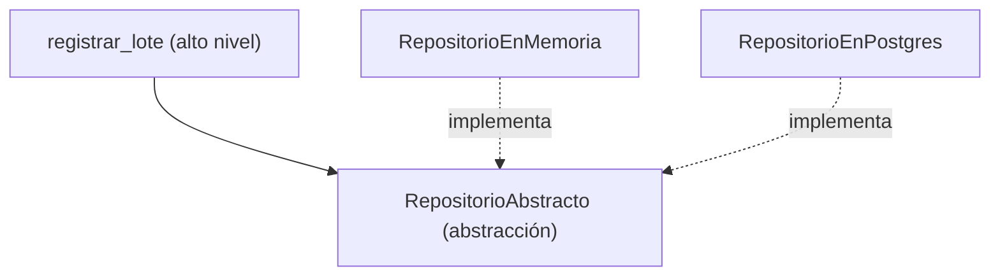

# Lección 17 — DIP (Dependency Inversion Principle) ⭐

> Fase 0 · SOLID · micro-paso · concepto nuevo: **depender de abstracciones**.
> Es el principio clave para todo el libro (Repository, Service Layer, DI).

## 0. 🧭 La pregunta
> *"Mi lógica crea la base de datos adentro, así que no puedo probarla sin una real
> ni cambiar de almacenamiento sin tocarla. ¿Cómo hago que no dependa del detalle?"*

## 1. Objetivo
Que el código de alto nivel dependa de una **abstracción** y reciba la implementación
por **inyección**.

## 2. Cita de la fuente
> *"High-level modules should not depend on low-level modules."*
> *"the dependency inversion principle (DIP) ... it's the D in SOLID."*
> — Introducción, *The Dependency Inversion Principle*

## 3. El dolor / necesidad
Si la lógica crea el detalle concreto adentro, no se puede probar ni cambiar sin tocarla.

## 4. Explicación paso a paso
1. DIP = el alto nivel depende de una abstracción, no de un detalle.
2. `RepositorioAbstracto` es la abstracción (contrato).
3. `RepositorioEnMemoria` es un detalle concreto.
4. `registrar_lote(repo, ...)` recibe el repo (inyección), no lo crea adentro.

Ver [`dip.py`](dip.py). Ejecutar:
```bash
uv run python lecciones/17-dip/dip.py
```

## 5. Diagrama (Mermaid)

El alto nivel y los detalles apuntan a la abstracción: nadie de arriba depende de abajo.

## 6. Árbol de archivos
```
lecciones/17-dip/
├── README.md
└── dip.py
```

## 7. Tu turno
Crea un `RepositorioFalso` e inyéctalo a `registrar_lote` sin cambiar la función.

## 8. Comprobación
Se comprueba ejecutando; opcionalmente pytest inyectando un repositorio falso.

## 9. Preguntas de recuerdo
1. ¿Qué dice el DIP?
2. ¿Qué es "inyectar" una dependencia?
3. ¿Por qué este principio es la base del Repository pattern del libro?
