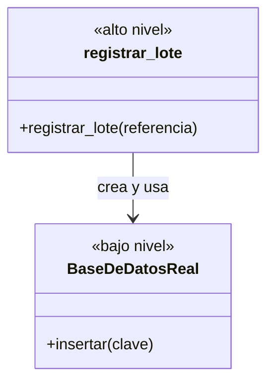
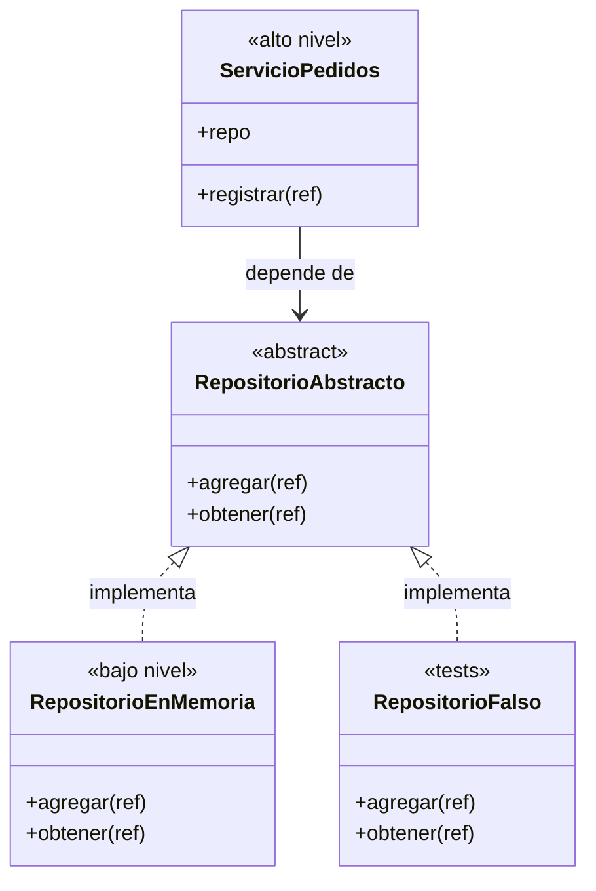

# Lección 17 — DIP (Dependency Inversion Principle) ⭐

> Fase 0 · Formulario · SOLID · Familia de concepto: **depender de abstracciones e inyectar los detalles** · Orden de estudio: **18 de 18**
> Es el principio clave para todo el libro: Repository (cap. 2), Service Layer (cap. 4) y Dependency Injection (cap. 13).

⬅️ [Lección 16 · ISP](../16-isp/) · 🏠 [Índice de lecciones](../README.md) · ➡️ [Fase 1 · Capítulo 1 · Domain Modeling](../../fase-1/capitulos/01-domain-modeling/)

---

## 🧭 Ruta de estudio · Lección 17 (≈ 2 h)

**Antes necesitas:** [Lección 12 · Abstracción](../12-abstraccion/) (`ABC`) y [Lección 16 · ISP](../16-isp/) (interfaces pequeñas).

| Paso | Qué haces | Dónde | ⏱ |
|:-:|---|---|:-:|
| **0** | Lee la teoría, las recetas, el diagnóstico, las propiedades y los errores | este README §0–§8 | 25 min |
| **1** | Ejecuta las recetas: de "crear el detalle adentro" a "recibirlo" | [`paso1_formulas.py`](paso1_formulas.py) | 10 min |
| **2** | Sigue los ejemplos resueltos (hasta un mini *service layer* con `FakeRepository`) | §9 + [`paso2_ejemplos_resueltos.py`](paso2_ejemplos_resueltos.py) | 20 min |
| **3** | Corre los tests (salen en **rojo**) y completa los `# TODO` hasta verlos en **verde** | [`paso3_tu_turno.py`](paso3_tu_turno.py) + [`test_paso3_tu_turno.py`](test_paso3_tu_turno.py) | 25 min |
| **4** | Compara con la solución de referencia | [`paso4_tu_turno_solucion.py`](paso4_tu_turno_solucion.py) | 5 min |
| **5** | Resuelve los 12 problemas, luego revisa claves y solucionario | §10–§11 + [`paso5_solucionario/`](paso5_solucionario/) | 25 min |
| **6** | Compara solución mala vs buena | [`paso6_ejercicios/`](paso6_ejercicios/) | 10 min |
| **7** | Responde las preguntas de recuerdo **sin mirar** | §15 | 5 min |
| **🚦** | Evalúa si puedes pasar a la Fase 1 | §16 | 1 min |

---

## 0. 🧭 La pregunta
> *"Mi lógica crea la base de datos adentro, así que no puedo probarla sin una real
> ni cambiar de almacenamiento sin tocarla. ¿Cómo hago que no dependa del detalle?"*

## 1. Objetivos (al terminar podrás…)
1. Enunciar las **dos partes** del DIP tal como las da el libro.
2. Distinguir código de **alto nivel** (el negocio) de **bajo nivel** (detalles técnicos).
3. **Inyectar** dependencias: por parámetro, por constructor y como función.
4. Probar la lógica con un **falso** (el `FakeRepository` del libro) en vez de una base de datos real.

## 2. Cita de la fuente
> *"You might be familiar with the dependency inversion principle (DIP) already, because it's
> the D in SOLID."* — Introducción, *The Dependency Inversion Principle*

> *"1. High-level modules should not depend on low-level modules. Both should depend on
> abstractions.
> 2. Abstractions should not depend on details. Instead, details should depend on
> abstractions."* — Introducción

> *"Depends on doesn't mean imports or calls, necessarily, but rather a more general idea that
> one module knows about or needs another module."* — Introducción

> *"the whole of Part I is essentially a worked example of implementing the DIP throughout an
> application"* — Introducción

> *"The simplest possible repository (repository.py) class AbstractRepository(abc.ABC):
> @abc.abstractmethod def add(self, batch: model.Batch): raise NotImplementedError"* — Cap. 2

**Por qué importa:** según los propios autores, **toda la Parte I** del libro es un ejemplo
trabajado del DIP. El `AbstractRepository` del cap. 2 es la abstracción, el repositorio de
SQLAlchemy es el detalle, y la *service layer* del cap. 4 recibe el repositorio en vez de
crearlo. Si entiendes esta lección, entiendes el esqueleto del libro.

## 3. El dolor
```python
def registrar_lote(referencia):
    bd = BaseDeDatosReal()          # ← la lógica CREA su detalle
    bd.insertar(referencia)
```
- **No se puede probar** sin una base de datos de verdad encendida.
- **No se puede cambiar** de almacenamiento (memoria, archivo, otra base) sin **editar la lógica**.
- La regla de negocio (lo que le importa a la empresa) queda **atada** a un detalle técnico (lo que no le importa).

---

## 4. 📘 Teoría

> **🎯 Definición — DIP (Principio de Inversión de Dependencias)**
> 1. Los módulos de **alto nivel** no deben depender de los de **bajo nivel**. **Ambos** deben
>    depender de **abstracciones**.
> 2. Las **abstracciones** no deben depender de los **detalles**. Los **detalles** deben depender
>    de las **abstracciones**.

> **🧩 Alto nivel, bajo nivel y abstracción**
>
> | Pieza | Qué es | Ejemplo en el libro |
> |---|---|---|
> | **Alto nivel** | lo que le importa al **negocio**: reglas, casos de uso | `allocate` (asignar stock) |
> | **Bajo nivel** (detalle) | lo **técnico**: bases de datos, archivos, email, HTTP | el repositorio de SQLAlchemy |
> | **Abstracción** | el contrato que **ambos** conocen | `AbstractRepository` (`add`, `get`) |
>
> "Inversión": antes la flecha iba **lógica → base de datos**. Ahora **las dos** apuntan a la
> abstracción, y el detalle "sube" a implementarla.

> **💉 Inyección de dependencias (la técnica)**
> **Inyectar** = darle a una pieza sus dependencias **desde afuera** en lugar de que las cree
> adentro. Tres formas, de la más simple a la más estructurada:
> 1. por **parámetro**: `registrar_lote(repo, ref)`
> 2. por **constructor**: `ServicioPedidos(repo)`
> 3. como **función**: `avisar_sin_stock(sku, enviar)` (para detalles simples, como `send_mail` en el cap. 13)

> **🔤 Vocabulario**
> - **Dependencia:** algo que una pieza **necesita** para funcionar (un repositorio, un notificador).
> - **Detalle:** una implementación concreta y técnica de una abstracción.
> - **Inyectar:** pasar la dependencia desde afuera.
> - **Componer / bootstrap:** el **único** lugar donde se decide qué detalle concreto se usa (cap. 13).
> - **Falso (*fake*):** un detalle de mentira, en memoria, para los tests.

> **🧠 Regla de oro**
> La lógica de negocio **no crea** sus detalles: **los recibe**.

---

## 5. 🧮 Formulario: recetas DIP
| # | Síntoma / olor | Regla | Plantilla de código | Qué logra |
|---|---|---|---|---|
| DIP1 | La lógica **crea** el detalle adentro (`bd = BaseDeDatosReal()`) | **Recibirlo** por parámetro | `def registrar_lote(repo, ref):` | La lógica no sabe qué detalle usa |
| DIP2 | No hay contrato: la lógica conoce los métodos del detalle | Define la **abstracción** con lo que el **alto nivel** necesita | `class RepositorioAbstracto(ABC): agregar / obtener` | Un contrato estable para ambos lados |
| DIP3 | El detalle no "encaja" en ningún contrato | El **detalle implementa** la abstracción | `class RepositorioEnMemoria(RepositorioAbstracto):` | Detalles intercambiables |
| DIP4 | Una clase de servicio crea su repositorio en `__init__` | Inyección por **constructor** | `def __init__(self, repo): self.repo = repo` | El servicio sirve con cualquier repo |
| DIP5 | Para probar hace falta la base de datos real | Inyecta un **falso** en los tests | `ServicioLotes(RepositorioFalso())` | Tests rápidos y sin infraestructura |
| DIP6 | La decisión "qué detalle usar" está regada por todas partes | **Componer** en **un** solo lugar | `def armar_servicio(modo): …` | Cambiar de detalle = cambiar una línea |
| DIP7 | El detalle es solo **una acción** (enviar un mensaje) | Inyecta una **función** | `avisar_sin_stock(sku, enviar)` | Lo más simple que funciona |

> 💡 Todas las recetas están ejecutables en [`paso1_formulas.py`](paso1_formulas.py), con su
> código (DIP1…DIP7) en cada línea de salida.

## 6. 🔍 Diagnóstico: ¿esta lógica viola el DIP?
| # | Pregunta | Si respondes… | …entonces |
|---|---|---|---|
| G1 | ¿La lógica **crea** (`X()`) o importa un detalle técnico adentro? | Sí | Inyéctalo → DIP1, DIP4 |
| G2 | ¿Puedo **probar** la lógica sin base de datos, internet ni email? | No | Falta una abstracción + falso → DIP2, DIP5 |
| G3 | Para **cambiar** de almacenamiento, ¿tengo que editar la lógica? | Sí | → DIP1, DIP3 |
| G4 | ¿La abstracción la define **quien la usa** (alto nivel) con palabras del negocio? | No (habla de SQL, tablas…) | La abstracción "filtra" el detalle (E2) |
| G5 | ¿En **cuántos** lugares se decide qué implementación usar? | Varios | Compón en uno → DIP6 |
| G6 | ¿Los tests usan un **falso** o tienen que parchear o *mockear*? | Parchear | La dependencia es implícita → inyéctala |

## 7. 📐 Propiedades y consecuencias
| # | Propiedad |
|---|---|
| **P1** | Alto nivel y bajo nivel dependen **los dos** de la abstracción, no uno del otro. |
| **P2** | Los detalles son **intercambiables** (memoria, archivo, SQLAlchemy…) sin tocar la lógica. |
| **P3** | Los tests son **rápidos**: se inyecta un falso en memoria. |
| **P4** | "Depende de" significa "**sabe de** o **necesita**", no solo "importa" (cita del libro). |
| **P5** | La abstracción **no conoce** los detalles; habla el idioma del **negocio**. |
| **P6** | La implementación concreta se elige en **un solo lugar** (el *bootstrap* del cap. 13). |

## 8. ⚠️ Errores frecuentes
| # | ❌ Así no | Qué pasa | ✅ Así sí |
|---|---|---|---|
| E1 | Crear el detalle **adentro** de la lógica | No se puede probar ni cambiar sin editarla | **Recíbelo** (DIP1, DIP4) |
| E2 | Una abstracción que "filtra" el detalle: `ejecutar_sql(consulta)` | La lógica sigue escribiendo SQL: sigue atada | Métodos del **negocio**: `guardar(pedido)`, `buscar(id)` |
| E3 | Creer que DIP = "usar herencia" | Hay herencia, pero la lógica igual crea su detalle | Lo clave es **la dirección** de la dependencia **y** la **inyección** |
| E4 | Inyectar la **clase** en vez de un **objeto**: `registrar_lote(RepositorioEnMemoria, "L1")` | `TypeError: RepositorioEnMemoria.agregar() missing 1 required positional argument: 'ref'` | Con paréntesis: `registrar_lote(RepositorioEnMemoria(), "L1")` |
| E5 | Crear la abstracción: `RepositorioAbstracto()` | `TypeError: Can't instantiate abstract class RepositorioAbstracto without an implementation for abstract methods 'agregar', 'obtener'` | Se crea un **detalle**; la abstracción solo es el contrato |
| E6 | Un falso que **no cumple** el contrato | Los tests pasan y producción falla | Comprueba el falso con un **test de contrato** (Lección 15) |

> 🔬 Pruébalos: al final de [`paso1_formulas.py`](paso1_formulas.py) están E4 y E5 comentados.
> Quita el `#` de **una** línea, ejecuta, lee el mensaje y vuelve a ponerlo.

---

## 9. ✍️ Ejemplos resueltos
> Todos están en [`paso2_ejemplos_resueltos.py`](paso2_ejemplos_resueltos.py).

**Ejemplo 1 — Registrar un lote recibiendo el repositorio** *(fácil)*
> Enunciado: escribe `registrar_lote` para que funcione con cualquier repositorio que cumpla el contrato.
```python
from abc import ABC, abstractmethod

# Paso 1: la abstracción (lo que la lógica NECESITA).
class RepositorioAbstracto(ABC):
    @abstractmethod
    def agregar(self, ref): ...
    @abstractmethod
    def obtener(self, ref): ...

# Paso 2: un detalle que la implementa.
class RepositorioEnMemoria(RepositorioAbstracto):
    def __init__(self): self._datos = {}
    def agregar(self, ref): self._datos[ref] = ref
    def obtener(self, ref): return self._datos.get(ref)

# Paso 3: la lógica RECIBE el repositorio (inyección por parámetro).
def registrar_lote(repo: RepositorioAbstracto, referencia):
    repo.agregar(referencia)
    return repo.obtener(referencia)

repo = RepositorioEnMemoria()             # decidimos AFUERA qué detalle usar
print(registrar_lote(repo, "LOTE-001"))   # -> LOTE-001
```

**Ejemplo 2 — Guardar notas sin atarse a un archivo** *(fácil)*
> Enunciado: `guardar_nota_atada` crea su `ArchivoTexto` adentro. Haz que lo reciba.
```python
class ArchivoTexto:                     # el detalle (simula un archivo con una lista)
    def __init__(self):
        self.lineas = []
    def escribir(self, texto):
        self.lineas.append(texto)

# Paso 1 (violación): la lógica crea su detalle.
def guardar_nota_atada(texto):
    archivo = ArchivoTexto()            # no lo puedo cambiar ni revisar desde afuera
    archivo.escribir(texto.upper())
    return len(archivo.lineas)

# Paso 2 (refactor, DIP1): la lógica recibe DÓNDE guardar.
def guardar_nota(texto, almacenamiento):
    almacenamiento.escribir(texto.upper())

# Paso 3 (uso): yo controlo el detalle y puedo revisar qué se guardó.
archivo = ArchivoTexto()
guardar_nota("hola", archivo)
guardar_nota("chau", archivo)
print("inyectada:", archivo.lineas)   # -> ['HOLA', 'CHAU']
```

**Ejemplo 3 — Servicio con inyección por constructor + test con falso** *(intermedio)*
> Enunciado: un `ServicioPedidos` que reciba su repositorio, y un test sin base de datos.
```python
# Paso 1 (DIP4): el servicio recibe el repositorio en __init__.
class ServicioPedidos:
    def __init__(self, repo):
        self.repo = repo
    def registrar(self, ref):
        self.repo.agregar(ref)
        return self.repo.obtener(ref)

# Paso 2 (DIP5): un falso que cumple el contrato (LSP, Lección 15).
class RepositorioFalso(RepositorioAbstracto):
    def __init__(self): self._datos = set()
    def agregar(self, ref): self._datos.add(ref)
    def obtener(self, ref): return ref if ref in self._datos else None

# Paso 3: el test no necesita base de datos.
falso = RepositorioFalso()
servicio = ServicioPedidos(falso)
assert servicio.registrar("P1") == "P1"
assert servicio.repo is falso            # usa EXACTAMENTE el que le inyecté
```
`a is b` responde si `a` y `b` son **el mismo objeto** (no solo iguales). Aquí prueba que el
servicio no creó otro repositorio por su cuenta.

**Ejemplo 4 — Un mini *service layer* con `FakeRepository`, como en los caps. 2 y 4** *(avanzado)*
> Enunciado: replica la abstracción `add`/`get` del libro, su `FakeRepository` con un `set`, y un
> servicio `asignar` que recibe el repositorio.
```python
# Paso 1: la abstracción del libro (cap. 2), con un método extra para listar.
class AbstractRepository(ABC):
    @abstractmethod
    def add(self, lote): ...
    @abstractmethod
    def get(self, referencia): ...
    @abstractmethod
    def list(self): ...

class Lote:
    def __init__(self, referencia, sku, cantidad):
        self.referencia = referencia
        self.sku = sku
        self.cantidad = cantidad

# Paso 2: el FakeRepository del libro guarda en un set.
class FakeRepository(AbstractRepository):
    def __init__(self, lotes): self._lotes = set(lotes)
    def add(self, lote): self._lotes.add(lote)
    def get(self, referencia):
        return next(l for l in self._lotes if l.referencia == referencia)
    def list(self): return list(self._lotes)

# Paso 3: el servicio (alto nivel) RECIBE el repo. En producción sería el de SQLAlchemy.
def asignar(sku, cantidad, repo: AbstractRepository):
    referencias = []
    for lote in repo.list():                 # un set no tiene orden: juntamos las referencias
        referencias.append(lote.referencia)
    for referencia in sorted(referencias):   # ...y las recorremos en orden
        lote = repo.get(referencia)
        if lote.sku == sku and lote.cantidad >= cantidad:
            lote.cantidad = lote.cantidad - cantidad
            return lote.referencia
    return None

repo = FakeRepository([Lote("lote-1", "MESA", 10), Lote("lote-2", "MESA", 50)])
print("asignar MESA x 20 ->", asignar("MESA", 20, repo))   # -> lote-2 (lote-1 solo tiene 10)
print("quedan en lote-2:", repo.get("lote-2").cantidad)    # -> 30
print("asignar SILLA x 1 ->", asignar("SILLA", 1, repo))   # -> None
```
`next(l for l in … if …)` es como lo escribe el libro: "el **primer** lote que cumpla la
condición". Este es, en pequeño, el esqueleto del cap. 4: un servicio que recibe un repositorio
abstracto y se prueba con un `FakeRepository`.

---

## 10. 📝 Problemas propuestos
> Resuélvelos **antes** de mirar las claves. Puedes crear tu propio archivo
> (`mis_problemas.py`) en esta carpeta.

**🟢 Nivel básico**
1. Clasifica en **alto nivel** o **bajo nivel**: `calcular_descuento`, `guardar_en_mysql`,
   `enviar_email_smtp`, `reglas_de_stock`.
2. En `repo = RepositorioEnMemoria()` + `registrar_lote(repo, "L1")`, ¿dónde está la inyección?
3. Esta función crea su repositorio adentro: `def registrar_lote(referencia): repo = RepositorioEnMemoria(); …`.
   Corrígela para que lo **reciba** y pruébala con `"LOTE-001"`.
4. Escribe un `RepositorioFalso` (con `set`) e inyéctalo a la **misma** `registrar_lote` sin
   cambiarla. Pruébala con `"LOTE-002"`.

**🟡 Nivel intermedio**

5. Escribe `class Tienda` que reciba su repositorio por el **constructor** y tenga
   `vender(producto)`, que lo guarda y devuelve `"vendido: …"`.
6. Escribe `registrar_venta(monto, notificar)` que reciba una **función** para avisar. Úsala una
   vez con una lista (`buzon_falso.append`) y otra con `print`.
7. ¿Qué error sale con `registrar_lote(RepositorioEnMemoria, "L1")`? Corrígelo.
8. Una abstracción tiene `ejecutar_sql(consulta)`. ¿Por qué sigue atando la lógica a SQL?
   Rediséñala con métodos del negocio (`guardar(pedido)`, `buscar(id_pedido)`) y pruébala.

**🔴 Nivel avanzado**

9. Escribe un `RepositorioArchivo` (que guarde en una lista `lineas`, simulando un archivo) y
   comprueba que `registrar_lote` funciona **igual** con él y con `RepositorioEnMemoria`, sin tocarla.
10. Escribe **3** `assert` que prueben `ServicioPedidos` usando un falso, sin base de datos.
11. Escribe `armar_app(modo)` que devuelva un `ServicioPedidos` con un `RepositorioFalso` si
    `modo == "test"` y con un `RepositorioEnMemoria` si no. ¿Qué repositorio tiene cada uno?
12. *(Puente al libro)* Escribe `AbstractRepository` (`add`, `get`), un `FakeRepository` con
    `set` y `reservar(referencia, cantidad, repo)`, que reste la cantidad si alcanza o devuelva
    `"no se pudo"`. Con `Lote("lote-1", 10)`: reserva 4, luego 9, luego `"lote-X"`.

## 11. 🔑 Claves (respuestas)
<details><summary>Ver claves (solo después de intentarlo)</summary>

| # | Respuesta / salida esperada | Receta / idea |
|---|---|---|
| 1 | alto: `calcular_descuento`, `reglas_de_stock` · bajo: `guardar_en_mysql`, `enviar_email_smtp` | §4 |
| 2 | El repositorio se **crea afuera** y se **pasa** como argumento a `registrar_lote` | DIP1 |
| 3 | `LOTE-001` | DIP1 |
| 4 | `LOTE-002` | DIP5 |
| 5 | `vendido: mesa` | DIP4 |
| 6 | se imprime `venta de 200`; el buzón falso queda `['venta de 100']` | DIP7 |
| 7 | `RepositorioEnMemoria.agregar() missing 1 required positional argument: 'ref'`; con `RepositorioEnMemoria()` → `L1` | E4 |
| 8 | Porque la lógica tendría que **escribir SQL**: sigue conociendo el detalle. Con `buscar('o1')` → `{'id': 'o1', 'total': 50}` | E2 |
| 9 | `RepositorioEnMemoria -> LOTE-9` y `RepositorioArchivo -> LOTE-9` | P2 |
| 10 | `OK (3 asserts sin base de datos)` | DIP5 |
| 11 | `RepositorioFalso \| RepositorioEnMemoria` | DIP6 |
| 12 | `reservado; quedan 6` / `no se pudo` / `no se pudo` | caps. 2 y 4 |

El código completo de cada solución está en [`paso5_solucionario/`](paso5_solucionario/):
[`nivel_basico.py`](paso5_solucionario/nivel_basico.py) ·
[`nivel_intermedio.py`](paso5_solucionario/nivel_intermedio.py) ·
[`nivel_avanzado.py`](paso5_solucionario/nivel_avanzado.py).
</details>

---

## 12. 🗺️ Diagrama antes / después (Mermaid)
**Antes** — la lógica depende directamente del detalle:

**Después** — ambos dependen de la abstracción; el detalle se inyecta:

**Cómo leerlo:** antes, la flecha va de la lógica (**alto nivel**) al detalle (**bajo nivel**):
la lógica **crea y usa** la base de datos. Después, la lógica apunta a la **abstracción**, y los
detalles **también** apuntan a ella (flechas punteadas = "implementa"). Esa es la **inversión**: el
detalle ahora depende del contrato, no al revés. Es exactamente la forma de la Parte I del libro
(`AbstractRepository` ← repositorio de SQLAlchemy / `FakeRepository`).

## 13. 🌳 Árbol de archivos
```
lecciones/17-dip/
├── README.md                    ← PASO 0 · EMPIEZA AQUÍ (este formulario)
├── paso1_formulas.py            ← PASO 1 · las recetas DIP1–DIP7, ejecutables
├── paso2_ejemplos_resueltos.py  ← PASO 2 · los 4 ejemplos resueltos
├── paso3_tu_turno.py            ← PASO 3 · completa los # TODO
├── test_paso3_tu_turno.py       ← PASO 3 · los tests (rojo → verde)
├── paso4_tu_turno_solucion.py   ← PASO 4 · solución de referencia
├── paso5_solucionario/          ← PASO 5 · soluciones de los 12 problemas
│   ├── nivel_basico.py
│   ├── nivel_intermedio.py
│   └── nivel_avanzado.py
└── paso6_ejercicios/            ← PASO 6 · solución mala vs buena
    ├── ejercicio-1/ … ejercicio-3/
    └── ejercicio-4-reto/
```

## 14. 🤝 Tu turno y ✅ comprobación con pytest
La comprobación es con **pytest**, al estilo **TDD**: los tests ya están escritos y
**empiezan en rojo a propósito**. Completa los `# TODO` de [`paso3_tu_turno.py`](paso3_tu_turno.py)
hasta que pasen a **verde**.
```bash
uv run pytest lecciones/17-dip -q
# al empezar: 4 failed   (rojo: falta tu código)
# al terminar: 4 passed  (verde)
```
Fíjate en `assert servicio.repo is repo` dentro de [`test_paso3_tu_turno.py`](test_paso3_tu_turno.py):
el test **exige** que el servicio use el repositorio que **le inyectaste**, y no uno creado por su cuenta.

Para comparar con la referencia:
```bash
git diff --no-index lecciones/17-dip/paso3_tu_turno.py lecciones/17-dip/paso4_tu_turno_solucion.py
```

## 15. ❓ Preguntas de recuerdo
> Respóndelas **sin mirar**; luego abre cada una para comprobar.

<details><summary>1. ¿Cuáles son las dos partes del DIP?</summary>

1) Los módulos de alto nivel no deben depender de los de bajo nivel: **ambos** dependen de
abstracciones. 2) Las abstracciones no dependen de los detalles: los **detalles** dependen de las
abstracciones.
</details>
<details><summary>2. ¿Qué es "inyectar" una dependencia?</summary>

Dársela a una pieza **desde afuera** (por parámetro, por constructor o como función) en lugar de que la cree adentro.
</details>
<details><summary>3. ¿Por qué este principio es la base del Repository pattern del libro?</summary>

Porque la lógica depende de `AbstractRepository` (la abstracción), y el repositorio de SQLAlchemy y
el `FakeRepository` son detalles que se inyectan. Así la lógica se prueba sin base de datos.
</details>
<details><summary>4. Según el libro, ¿"depende de" significa "importa"?</summary>

**No necesariamente**: significa que un módulo **sabe de** o **necesita** a otro.
</details>
<details><summary>5. ¿Qué error ves si pasas <code>RepositorioEnMemoria</code> sin paréntesis?</summary>

`TypeError: RepositorioEnMemoria.agregar() missing 1 required positional argument: 'ref'`: pasaste la
**clase** en vez de un **objeto**.
</details>
<details><summary>6. ¿Dónde se decide qué detalle concreto se usa?</summary>

En **un solo lugar** que compone la aplicación (el *bootstrap* del cap. 13); en los tests, el test
mismo inyecta el falso.
</details>

---

## 16. 🚦 ¿Puedo pasar a la Fase 1?
| Indicador | Criterio |
|:-:|---|
| 🟢 **Sí, sigue** | `uv run pytest lecciones/17-dip -q` sale en **verde** (4 passed) **y** aciertas **≥ 9 de 12** problemas **y** respondes las 6 preguntas sin mirar |
| 🟡 **Repasa** | aciertas **6 a 8** → vuelve a §8 (errores frecuentes) y §9 (ejemplos resueltos) y reintenta los que fallaste |
| 🔴 **Repite la lección** | aciertas **menos de 6** → empieza otra vez desde el Paso 0 |

Cuando estés en 🟢, marca la lección en
[`progreso/fase-0-python.md`](../../progreso/fase-0-python.md) (sección *"Mi avance"*) y haz
commit; así también practicas Git. 🎉 Con esta lección **terminas la Fase 0**: lo siguiente es el
libro, empezando por el [Capítulo 1 · Domain Modeling](../../fase-1/capitulos/01-domain-modeling/).

---

⬅️ [Lección 16 · ISP](../16-isp/) · 🏠 [Índice de lecciones](../README.md) · ➡️ [Fase 1 · Capítulo 1 · Domain Modeling](../../fase-1/capitulos/01-domain-modeling/)
