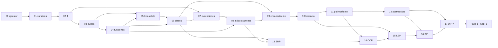

# Lecciones — Fase 0 (Python, POO y SOLID)

🏠 [Inicio](../README.md) · 📖 [Cómo estudiar](../COMO-ESTUDIAR.md) · ➡️ [Fase 1 · Capítulos del libro](../fase-1/capitulos/README.md)

Estúdialas **en orden** (columna *Orden*). Cada lección es un **formulario**: empiezas por su
`README.md` (paso 0) y sigues los archivos `paso1_…` a `paso6_…`. Al final, su **semáforo 🚦**
te dice si puedes pasar a la siguiente.

---

## ▶ Ruta de estudio

| Orden | Lección | Qué aprendes | Antes necesitas | ⏱ aprox. |
|:-:|---|---|---|:-:|
| **1** | [00 · ¿Qué es ejecutar un programa?](00-que-es-ejecutar-un-programa/) | instalar Python y `uv`, ejecutar un archivo, `print` | nada | 45 min |
| **2** | [01 · Variables y tipos](01-variables-y-tipos/) | guardar datos: `int`, `float`, `str`, `bool` | 00 | 1.5 h |
| **3** | [02 · Condicionales](02-condicionales/) | decidir con `if` / `elif` / `else`, comparar | 01 | 1.5 h |
| **4** | [03 · Bucles](03-bucles/) | repetir con `for` / `while`, `range`, acumular | 02 | 2 h |
| **5** | [04 · Funciones](04-funciones/) | `def`, parámetros, `return` | 03 | 2 h |
| **6** | [05 · Listas y diccionarios](05-listas-y-diccionarios/) | colecciones: por posición y por clave | 03, 04 | 2 h |
| **7** | [06 · Clases y objetos](06-clases-y-objetos/) | clase → instancia → objeto → uso | 04, 05 | 2.5 h |
| **8** | [07 · Excepciones](07-excepciones/) | errores con `raise` / `try` / `except` | 02, 06 | 2 h |
| **9** | [08 · Módulos, `uv` y primer pytest](08-modulos-y-pytest/) | `import`, entorno y tests automáticos | 04, 07 | 2.5 h |
| | **POO a fondo** | | | |
| **10** | [09 · Encapsulación](09-encapsulacion/) | proteger el estado del objeto | 06, 08 | 2 h |
| **11** | [10 · Herencia](10-herencia/) | reutilizar y extender una clase | 09 | 2 h |
| **12** | [11 · Polimorfismo](11-polimorfismo/) | misma interfaz, distintos comportamientos | 10 | 2 h |
| **13** | [12 · Abstracción (ABC)](12-abstraccion/) | clases abstractas, `abc.ABC` | 11 | 2 h |
| | **SOLID** | | | |
| **14** | [13 · SRP](13-srp/) | una clase, una razón para cambiar | 06, 08 | 1.5 h |
| **15** | [14 · OCP](14-ocp/) | extender sin modificar | 11, 13 | 1.5 h |
| **16** | [15 · LSP](15-lsp/) | la hija puede sustituir a la madre | 10, 14 | 1.5 h |
| **17** | [16 · ISP](16-isp/) | interfaces pequeñas | 12, 15 | 1.5 h |
| **18** | [17 · DIP ⭐](17-dip/) | depender de abstracciones (clave para el libro) | 12, 16 | 2 h |

**Total Fase 0:** ≈ 33 h. Al terminar la 17 → [Fase 1 · Capítulo 1](../fase-1/capitulos/01-domain-modeling/).

## 🗺️ Mapa de dependencias


**Cómo leerlo:** una flecha `A → B` significa "**B usa lo que aprendiste en A**". Si una
lección te cuesta, sigue sus flechas hacia atrás para saber qué repasar.

## 🧩 Qué trae cada lección

```
lecciones/NN-nombre/
├── README.md                    ← PASO 0 · EMPIEZA AQUÍ (el formulario)
├── paso1_formulas.py            ← PASO 1 · fórmulas ejecutables
├── paso2_ejemplos_resueltos.py  ← PASO 2 · ejemplos resueltos
├── paso3_tu_turno.py            ← PASO 3 · huecos # TODO
├── paso4_tu_turno_solucion.py   ← PASO 4 · solución de referencia
├── test_paso3_tu_turno.py       ← (desde la 08) el test de tu paso3
├── paso5_solucionario/          ← PASO 5 · soluciones de los 12 problemas
└── paso6_ejercicios/            ← PASO 6 · solución mala vs buena
```
Detalle de cada paso en [Cómo estudiar](../COMO-ESTUDIAR.md).

## Cómo repasar una lección con Git

1. **Lo más simple:** abre el `README.md` de la lección (en GitHub o en tu editor).
2. **Volver al estado exacto de una lección** (marcador con rama):
   ```bash
   git switch repaso/leccion-01   # el repo tal como quedó en la Lección 01
   git switch -                   # volver a donde estabas
   ```
   > Las ramas `repaso/leccion-NN` guardan la versión **anterior** al formato formulario.
3. **Ver qué cambió en una lección** (su commit):
   ```bash
   git show repaso/leccion-02
   ```

> Nota: usamos **ramas** (`repaso/leccion-NN`) en vez de tags porque la integración de
> GitHub de esta sesión permite subir ramas pero no etiquetas.

---

🏠 [Inicio](../README.md) · 📖 [Cómo estudiar](../COMO-ESTUDIAR.md) · ➡️ [Fase 1 · Capítulos del libro](../fase-1/capitulos/README.md)
