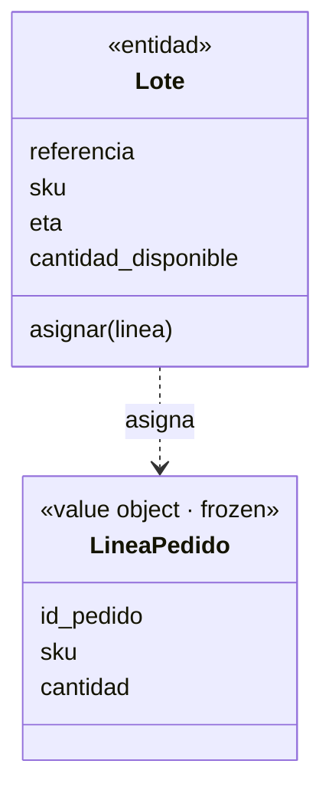

# Capítulo 1 — Domain Modeling (apuntes)

## Micro-lección 1 — El primer test y el modelo
- **Pregunta:** asignar una línea de pedido a un lote y que baje el stock.
- **Cita:** *"batch.allocate(line); assert batch.available_quantity == 18"* (Cap. 1).
- **TDD:** escribí el test primero (rojo: no existía `modelo`), luego el modelo mínimo (verde).
- **Conceptos:**
  - `LineaPedido` = *value object* (`@dataclass(frozen=True)`, inmutable, solo datos).
  - `Lote` = *entidad* (identidad por `referencia`, estado `cantidad_disponible` que cambia).
- **Código:** `proyecto/modelo.py`, `proyecto/test_modelo.py`.

